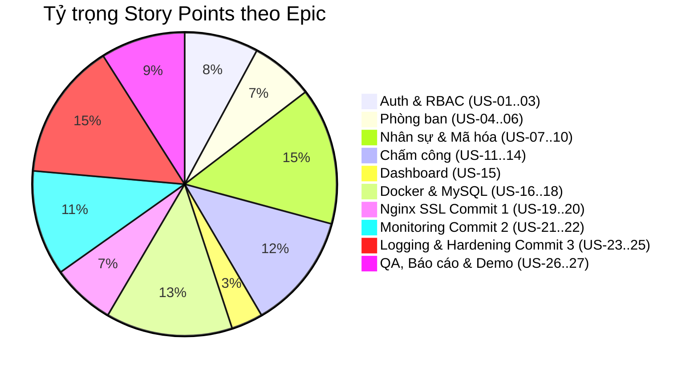

# 📋 PRODUCT BACKLOG: HỆ THỐNG QUẢN LÝ NHÂN SỰ (HRM)
**Học phần:** Triển khai và Quản trị Hệ thống Phần mềm (TKQT HTPM K23)  
**Đề tài:** Đề 10 - Hệ thống Quản lý Nhân sự (HRM)  
**Công nghệ:** Node.js (Express) | MySQL 8.0 | phpMyAdmin | Nginx | Prometheus | Grafana | Loki | Promtail  
**Phiên bản:** 1.0.0 | **Ngày lập:** 13/10/2026  

---

## 🎯 1. TỔNG QUAN VÀ TẦM NHÌN SẢN PHẨM (PRODUCT VISION & GOAL)
- **Tầm nhìn (Vision):** Xây dựng một hệ thống Quản lý Nhân sự (HRM) tinh gọn, hiện đại, bảo mật cao; hỗ trợ doanh nghiệp quản lý hồ sơ nhân viên, cơ cấu phòng ban và chấm công thời gian thực.
- **Mục tiêu kỹ thuật (DevOps Goal):** Đóng gói toàn bộ hệ thống bằng Docker Compose, áp dụng mô hình mạng đa tầng (Dual-Network), triển khai Reverse Proxy HTTPS, bảo mật dữ liệu định danh (mã hóa AES), hệ thống giám sát thời gian thực (Prometheus/Grafana), nhật ký tập trung (Loki/Promtail) và các giải pháp gia cố bảo mật (Hardening).
- **Chuẩn đánh giá:** Đáp ứng 100% tiêu chuẩn đánh giá của học phần (10 điểm, 3 Commit mốc trên GitHub, báo cáo kỹ thuật $\ge$ 10 trang).

---

## 👥 2. DANH SÁCH ACTOR & VAI TRÒ HỆ THỐNG
1. **Admin (Quản trị viên hệ thống):** Toàn quyền quản trị tài khoản, phân quyền, phòng ban, nhân sự, chấm công và theo dõi sức khỏe hạ tầng.
2. **HR Manager (Quản lý nhân sự):** Quản lý hồ sơ nhân viên, duyệt và quản lý bảng chấm công, xem báo cáo nhân sự toàn công ty.
3. **Employee (Nhân viên):** Xem hồ sơ cá nhân, thực hiện Check-in / Check-out hàng ngày, theo dõi lịch sử chấm công của bản thân.
4. **DevOps / SysAdmin:** Vận hành hệ thống giám sát, phân tích log, kiểm soát bảo mật, sao lưu CSDL.

---

## 📐 3. DEFINITION OF READY (DoR) & DEFINITION OF DONE (DoD)

### Definition of Ready (DoR) - Điều kiện để đưa User Story vào Sprint:
- [x] User Story được viết theo định dạng chuẩn: *"Là một [Actor], tôi muốn [Hành động], để [Lợi ích]"*.
- [x] Tiêu chí nghiệm thu (Acceptance Criteria) được xác định rõ ràng theo dạng Given-When-Then.
- [x] Đã ước lượng độ phức tạp (Story Points).
- [x] Đã xác định rõ mức độ ưu tiên (P0: Bắt buộc, P1: Quan trọng, P2: Nâng cao).
- [x] Không còn phụ thuộc kỹ thuật chưa được giải quyết.

### Definition of Done (DoD) - Điều kiện để hoàn thành một User Story:
- [x] Mã nguồn được viết sạch sẽ, có chú thích đầy đủ, tuân thủ Clean Code.
- [x] API có validation dữ liệu đầu vào và xử lý lỗi chuẩn HTTP Status Codes.
- [x] Chức năng chạy ổn định trên container Docker, không gây crash hoặc rò rỉ bộ nhớ.
- [x] Đã kiểm thử chức năng (Functional Test) và xác thực quyền hạn (RBAC).
- [x] Mã nguồn và cấu hình được commit lên Git với message rõ ràng, đúng quy chuẩn.

---

## 📊 4. PHÂN LOẠI MỨC ĐỘ ƯU TIÊN (PRIORITY FRAMEWORK)
- **P0 (Must Have - Bắt buộc):** Chức năng cốt lõi bắt buộc phải có để hệ thống vận hành và đạt điểm môn học.
- **P1 (Should Have - Quan trọng):** Chức năng tăng cường độ tin cậy, tối ưu trải nghiệm và bảo mật nâng cao.
- **P2 (Could Have - Nâng cao):** Tính năng mở rộng, giao diện nâng cao hoặc cảnh báo tự động.

---

## 📑 5. BẢNG PRODUCT BACKLOG CHI TIẾT (EPIC & USER STORIES)

### EPIC 1: XÁC THỰC, PHÂN QUYỀN & QUẢN TRỊ NGƯỜI DÙNG (AUTH & RBAC)
| ID | User Story | Priority | SP | Acceptance Criteria (Tiêu chí nghiệm thu) | Sprint |
| :---: | :--- | :---: | :---: | :--- | :---: |
| **US-01** | **Đăng nhập hệ thống bằng JWT** *Là một* người dùng hệ thống (Admin/HR/Emp), *Tôi muốn* đăng nhập bằng tài khoản và mật khẩu, *Để* truy cập vào các chức năng được phân quyền tương ứng. | **P0** | 3 | • **Given:** Người dùng nhập username và password. • **When:** Nhấn "Đăng nhập". • **Then:** Nếu đúng, trả về JWT Token và thông tin user; nếu sai, báo lỗi "Sai tài khoản hoặc mật khẩu"; mật khẩu lưu dạng băm bcrypt. | Sprint 1 |
| **US-02** | **Phân quyền truy cập theo vai trò (RBAC)** *Là một* Admin, *Tôi muốn* hệ thống chặn các truy cập trái phép vào tài nguyên của nhau, *Để* bảo vệ dữ liệu nhạy cảm của doanh nghiệp. | **P0** | 3 | • Employee chỉ xem được thông tin cá nhân và lịch sử công của mình. • HR Manager quản lý nhân viên và phòng ban. • Admin có toàn quyền. • Request không có token hoặc sai quyền trả về HTTP 401/403. | Sprint 1 |
| **US-03** | **Đăng xuất & Quản lý phiên làm việc** *Là một* người dùng, *Tôi muốn* đăng xuất khỏi hệ thống, *Để* kết thúc phiên làm việc an toàn trên máy tính dùng chung. | **P1** | 1 | • Xóa token tại client (localStorage/cookie), chuyển hướng về trang Login. | Sprint 1 |

---

### EPIC 2: QUẢN LÝ CƠ CẤU TỔ CHỨC & PHÒNG BAN (DEPARTMENT MANAGEMENT)
| ID | User Story | Priority | SP | Acceptance Criteria (Tiêu chí nghiệm thu) | Sprint |
| :---: | :--- | :---: | :---: | :--- | :---: |
| **US-04** | **Xem danh sách phòng ban** *Là một* HR Manager / Admin, *Tôi muốn* xem danh sách các phòng ban kèm số lượng nhân viên, *Để* nắm bắt cơ cấu tổ chức của công ty. | **P0** | 2 | • Hiển thị bảng gồm: Mã PB, Tên PB, Địa điểm, Số điện thoại, Số nhân sự hiện tại. • Có ô tìm kiếm theo tên phòng ban. | Sprint 1 |
| **US-05** | **Thêm mới phòng ban** *Là một* HR Manager / Admin, *Tôi muốn* tạo thêm một phòng ban mới, *Để* mở rộng quy mô tổ chức. | **P0** | 2 | • Form nhập: Mã PB (duy nhất), Tên PB, Địa điểm, Số điện thoại, Mô tả. • Validate không để trống mã và tên; báo lỗi nếu trùng mã. | Sprint 1 |
| **US-06** | **Chỉnh sửa & Xóa phòng ban** *Là một* Admin, *Tôi muốn* cập nhật thông tin hoặc xóa phòng ban rỗng, *Để* duy trì dữ liệu chính xác. | **P1** | 2 | • Cho phép sửa tên, địa điểm, số điện thoại. • Không cho phép xóa phòng ban nếu vẫn còn nhân viên đang trực thuộc (báo lỗi ràng buộc). | Sprint 1 |

---

### EPIC 3: QUẢN LÝ HỒ SƠ NHÂN SỰ & AN TOÀN DỮ LIỆU ĐỊNH DANH (EMPLOYEE MANAGEMENT)
| ID | User Story | Priority | SP | Acceptance Criteria (Tiêu chí nghiệm thu) | Sprint |
| :---: | :--- | :---: | :---: | :--- | :---: |
| **US-07** | **Xem danh sách nhân viên có phân trang** *Là một* HR Manager / Admin, *Tôi muốn* xem danh sách nhân sự với bộ lọc phòng ban và trạng thái, *Để* quản lý nhân sự thuận tiện. | **P0** | 3 | • Bảng hiển thị: Mã NV, Họ tên, Phòng ban, Chức vụ, Trạng thái (Active/OnLeave/Resigned). • Hỗ trợ tìm kiếm theo tên/mã và phân trang (10 nhân viên/trang). | Sprint 1 |
| **US-08** | **Thêm mới nhân sự & Mã hóa CCCD (pgcrypto/AES)** *Là một* HR Manager, *Tôi muốn* tạo hồ sơ nhân viên mới với số CCCD được mã hóa, *Để* bảo vệ dữ liệu cá nhân theo tiêu chuẩn an toàn thông tin (Lab 6). | **P0** | 5 | • Form nhập: Mã NV, Họ tên, Ngày sinh, Giới tính, CCCD/CMND, Email, SĐT, Phòng ban, Lương cơ bản. • **Bắt buộc:** Số CCCD phải được mã hóa bằng `AES_ENCRYPT(ssn, key)` lưu kiểu `VARBINARY(255)` trong CSDL MySQL. • Kiểm tra tính duy nhất của Mã NV và Email. | Sprint 1 |
| **US-09** | **Xem chi tiết & Giải mã dữ liệu CCCD có thẩm quyền** *Là một* HR Manager / Admin, *Tôi muốn* xem chi tiết hồ sơ nhân viên bao gồm số CCCD đã giải mã, *Để* phục vụ công tác thủ tục nhân sự. | **P0** | 3 | • Chỉ Admin và HR Manager mới được giải mã (`AES_DECRYPT`) để hiển thị CCCD đầy đủ. • User khác không được xem hoặc bị che ký tự (vd: `0380******12`). | Sprint 1 |
| **US-10** | **Cập nhật hồ sơ & Chuyển trạng thái nghỉ việc** *Là một* HR Manager / Admin, *Tôi muốn* cập nhật chức vụ hoặc chuyển trạng thái sang "Resigned", *Để* lưu trữ lịch sử mà không xóa vĩnh viễn dữ liệu. | **P1** | 2 | • Cập nhật thông tin liên hệ, phòng ban, lương. • Thao tác "Xóa" thực chất là Soft-delete (chuyển trạng thái thành `Resigned`, khóa tài khoản đăng nhập). | Sprint 1 |

---

### EPIC 4: QUẢN LÝ CHẤM CÔNG & ĐIỂM DANH (ATTENDANCE TRACKING)
| ID | User Story | Priority | SP | Acceptance Criteria (Tiêu chí nghiệm thu) | Sprint |
| :---: | :--- | :---: | :---: | :--- | :---: |
| **US-11** | **Nhân viên Check-in vào ca hàng ngày** *Là một* Nhân viên, *Tôi muốn* bấm nút "Check-in" khi bắt đầu ngày làm việc, *Để* ghi nhận thời gian bắt đầu làm việc chính xác. | **P0** | 3 | • Ghi nhận thời gian thực từ máy chủ (Server timestamp). • Tự động tính toán: Nếu trước 08:30 $\rightarrow$ `OnTime` (Đúng giờ); sau 08:30 $\rightarrow$ `Late` (Đi muộn). • Mỗi nhân viên chỉ được Check-in 1 lần/ngày. | Sprint 1 |
| **US-12** | **Nhân viên Check-out kết thúc ca làm** *Là một* Nhân viên, *Tôi muốn* bấm nút "Check-out" khi tan làm, *Để* hoàn thành bản ghi chấm công trong ngày. | **P0** | 2 | • Ghi nhận thời gian check-out. • Nếu trước 17:30 và trạng thái đang là `OnTime` $\rightarrow$ cập nhật ghi chú hoặc chuyển trạng thái `EarlyLeave` (Về sớm). | Sprint 1 |
| **US-13** | **Bảng theo dõi chấm công hôm nay (Daily Attendance)** *Là một* HR Manager, *Tôi muốn* xem danh sách chấm công toàn công ty trong ngày hôm nay, *Để* biết ai đã đi làm, ai đi muộn, ai vắng mặt. | **P0** | 3 | • Hiển thị bảng tổng hợp ngày hiện tại: Họ tên, Phòng ban, Giờ vào, Giờ ra, Trạng thái (Badge màu xanh/vàng/đỏ). • Lọc theo phòng ban. | Sprint 1 |
| **US-14** | **Lịch sử chấm công theo tháng** *Là một* Nhân viên / HR Manager, *Tôi muốn* xem bảng chấm công chi tiết theo tháng, *Để* đối soát ngày công làm việc phục vụ tính lương. | **P1** | 3 | • Chọn tháng/năm, hiển thị toàn bộ các ngày có phát sinh công. • Tính tổng: Số ngày đúng giờ, số lần đi muộn, số lần về sớm. | Sprint 1 |

---

### EPIC 5: BÁO CÁO THỐNG KÊ & DASHBOARD ĐIỀU HÀNH
| ID | User Story | Priority | SP | Acceptance Criteria (Tiêu chí nghiệm thu) | Sprint |
| :---: | :--- | :---: | :---: | :--- | :---: |
| **US-15** | **Dashboard thống kê tổng quan (Executive Dashboard)** *Là một* Quản lý, *Tôi muốn* nhìn thấy các thẻ chỉ số quan trọng ngay khi đăng nhập, *Để* nắm bắt nhanh tình hình công ty. | **P0** | 3 | • Thẻ 1: Tổng số nhân sự hiện tại. • Thẻ 2: Số lượng phòng ban. • Thẻ 3: Tỷ lệ đi làm hôm nay (Số người check-in / Tổng nhân viên). • Biểu đồ phân bổ nhân viên theo từng phòng ban. | Sprint 1 |

---

### EPIC 6: HẠ TẦNG DOCKER COMPOSE, MYSQL & PHẦN QUYỀN LEAST PRIVILEGE
| ID | User Story | Priority | SP | Acceptance Criteria (Tiêu chí nghiệm thu) | Sprint |
| :---: | :--- | :---: | :---: | :--- | :---: |
| **US-16** | **Khởi tạo CSDL MySQL & Phân quyền Least Privilege** *Là một* Database Administrator, *Tôi muốn* khởi tạo tự động schema và phân quyền an toàn theo Lab 6, *Để* bảo vệ dữ liệu khỏi rủi ro phá hoại hoặc leo thang đặc quyền. | **P0** | 5 | • Tệp `database/init.sql` tạo sẵn cấu trúc bảng và seed data. • Tạo user `app_user`: Cấp `SELECT, INSERT, UPDATE, DELETE`. • Tạo user `report_user`: Chỉ cấp `SELECT`. • Kiểm tra: `app_user` và `report_user` không thể thực hiện lệnh `DROP TABLE`. • Bật `general_log = 1` ghi log truy vấn CSDL. | Sprint 1 |
| **US-17** | **Đóng gói ứng dụng bằng Docker Compose & Healthcheck** *Là một* DevOps Engineer, *Tôi muốn* toàn bộ dịch vụ khởi chạy ổn định qua docker-compose, *Để* hệ thống dễ dàng triển khai và kiểm thử nhất quán. | **P0** | 5 | • Dockerfile chạy dưới user **non-root** (`USER node`). • Cấu hình Docker Named Volume lưu trữ dữ liệu MySQL bền vững. • Cấu hình Healthcheck cho MySQL (`mysqladmin ping`). • Ứng dụng phụ thuộc vào DB qua `condition: service_healthy`. | Sprint 1 |
| **US-18** | **Triển khai công cụ quản trị CSDL phpMyAdmin** *Là một* Quản trị viên CSDL, *Tôi muốn* truy cập giao diện phpMyAdmin để kiểm tra bảng và dữ liệu, *Để* hoàn thành tiêu chí số 2 của giảng viên (1.5 điểm). | **P0** | 2 | • Container `phpmyadmin` kết nối thông suốt tới `mysql-db`. • Đăng nhập được bằng tài khoản root và app_user để đối soát quyền. | Sprint 1 |

---

### EPIC 7: REVERSE PROXY NGINX, HTTPS TỰ KÝ & COMMIT MỐC 1 (COMMIT 1)
| ID | User Story | Priority | SP | Acceptance Criteria (Tiêu chí nghiệm thu) | Sprint |
| :---: | :--- | :---: | :---: | :--- | :---: |
| **US-19** | **Cấu hình Nginx Reverse Proxy & Tên miền Local** *Là một* Kỹ sư hệ thống, *Tôi muốn* Nginx làm cổng tiếp nhận duy nhất cho toàn bộ dịch vụ, *Để* che giấu kiến trúc backend và tăng cường an ninh mạng (Lab 1 & 5). | **P0** | 3 | • Cấu hình chuyển tiếp: `/` trỏ về `hrm-app:8080`, `/phpmyadmin/` trỏ về `phpmyadmin:80`. • Truyền đủ headers: `Host`, `X-Real-IP`, `X-Forwarded-For`, `X-Forwarded-Proto`. • Ánh xạ tên miền `127.0.0.1 hrm.local` qua file hosts. | Sprint 1 |
| **US-20** | **Cấu hình HTTPS tự ký (SSL OpenSSL) & Security Headers** *Là một* Chuyên viên an ninh mạng, *Tôi muốn* website hoạt động trên giao thức HTTPS an toàn, *Để* hoàn thành Tiêu chí số 3 của môn học (1.5 điểm) và Commit 1. | **P0** | 3 | • Tạo SSL Certificate tự ký chuẩn X.509 RSA 2048-bit bằng OpenSSL. • Tự động chuyển hướng toàn bộ truy cập HTTP cổng 80 sang HTTPS cổng 443 (HTTP 301). • Bật Security Headers: `X-Frame-Options`, `X-Content-Type-Options`, `X-XSS-Protection`. • **Commit mốc 1** lên GitHub với commit message chuẩn. | Sprint 1 |

---

### EPIC 8: HỆ THỐNG GIÁM SÁT PROMETHEUS + GRAFANA (COMMIT 2)
| ID | User Story | Priority | SP | Acceptance Criteria (Tiêu chí nghiệm thu) | Sprint |
| :---: | :--- | :---: | :---: | :--- | :---: |
| **US-21** | **Thiết lập kiến trúc 2 mạng Docker & Scrape Metrics** *Là một* SRE Engineer, *Tôi muốn* tách biệt mạng ứng dụng và mạng giám sát theo chuẩn Lab 7, *Để* đảm bảo an toàn và cô lập tài nguyên. | **P0** | 5 | • Tách 2 mạng: `app-network` và `monitoring`. • Triển khai `mysqld-exporter:v0.14.0` (port 9104) tham gia cả 2 mạng. • Triển khai `cadvisor` (container stats) và `node-exporter` (host stats). • Endpoint `/metrics` trên `hrm-app` cung cấp chỉ số ứng dụng. • Tất cả 5 targets trên Prometheus đều hiển thị trạng thái `UP`. | Sprint 2 |
| **US-22** | **Xây dựng Dashboard trực quan hóa trên Grafana** *Là một* Giám sát viên hệ thống, *Tôi muốn* theo dõi biểu đồ CPU, RAM, Disk và MySQL thời gian thực, *Để* hoàn thành Tiêu chí số 4 (1.5 điểm) và Commit 2. | **P0** | 5 | • Nguồn dữ liệu Prometheus được provisioning tự động. • Import thành công Dashboard Node Exporter Full (ID: 1860). • Import thành công Dashboard Docker cAdvisor (ID: 14282 / 193). • Import thành công Dashboard MySQL Overview (ID: 7362). • **Commit mốc 2** lên GitHub với commit message chuẩn. | Sprint 2 |

---

### EPIC 9: HỆ THỐNG LOG TẬP TRUNG LOKI + PROMTAIL & CẢNH BÁO ALERTMANAGER (COMMIT 3)
| ID | User Story | Priority | SP | Acceptance Criteria (Tiêu chí nghiệm thu) | Sprint |
| :---: | :--- | :---: | :---: | :--- | :---: |
| **US-23** | **Thu thập log tập trung với Loki & Promtail** *Là một* SysAdmin, *Tôi muốn* toàn bộ log stdout/stderr của container được gom về một nơi, *Để* truy vết sự cố nhanh chóng mà không cần SSH vào từng container (Lab 8). | **P0** | 5 | • Promtail đọc log từ socket `/var/run/docker.sock` và tự động gắn nhãn `container`, `service`. • Loki lưu trữ log theo chuẩn boltdb-shipper / filesystem. • Kết nối Data Source Loki vào Grafana thành công. | Sprint 3 |
| **US-24** | **Truy vấn LogQL trên Grafana Explore** *Là một* SysAdmin, *Tôi muốn* thực hiện các truy vấn lọc log theo cú pháp LogQL, *Để* hoàn thành Tiêu chí số 5 của môn học (1.5 điểm). | **P0** | 3 | • Viết và chạy thành công tối thiểu 3 truy vấn LogQL:   1. `{container="hrm-app"}`   2. `{container="hrm-app"} \|= "error"`   3. `{container="mysql-db"} \|= "error"`   4. `{container="hrm-app"} \|= "POST /api/attendance"`. | Sprint 3 |
| **US-25** | **Cấu hình quy tắc cảnh báo Alertmanager & Hardening** *Là một* DevSecOps Engineer, *Tôi muốn* hệ thống tự động phát hiện khi quá tải CPU/RAM/DB connections, *Để* hoàn thành Tiêu chí số 6 (1.5 điểm) và Commit 3. | **P0** | 5 | • Thiết lập `rules/alerts.yml` (High CPU > 80%, High RAM > 85%, MySQL Too Many Connections > 80). • Alertmanager nhận cảnh báo từ Prometheus. • Áp dụng Hardening: Không public port nội bộ, non-root user, resource limits. • **Commit mốc 3** lên GitHub hoàn tất 100% mã nguồn. | Sprint 3 |

---

### EPIC 10: KIỂM THỬ TOÀN DIỆN, BÁO CÁO NGHIỆM THU & DEMO BẢO VỆ
| ID | User Story | Priority | SP | Acceptance Criteria (Tiêu chí nghiệm thu) | Sprint |
| :---: | :--- | :---: | :---: | :--- | :---: |
| **US-26** | **Kiểm thử tích hợp & Tối ưu hóa toàn hệ thống** *Là một* QA / Tech Lead, *Tôi muốn* kiểm tra toàn bộ luồng hoạt động từ đầu đến cuối, *Để* đảm bảo không có lỗi phát sinh khi chạy demo. | **P0** | 3 | • Chạy test toàn bộ luồng: Login $\rightarrow$ Tạo phòng ban $\rightarrow$ Thêm NV (mã hóa CCCD) $\rightarrow$ Check-in/out $\rightarrow$ Xem Dashboard $\rightarrow$ Xem Grafana $\rightarrow$ Truy vấn LogQL. | Sprint 3 |
| **US-27** | **Soạn thảo Báo cáo Kỹ thuật $\ge$ 10 trang & Kịch bản Demo** *Là một* Sinh viên thực hiện, *Tôi muốn* hoàn thiện báo cáo chuẩn mẫu đồ án và kịch bản thuyết trình, *Để* đạt điểm tối đa Tiêu chí số 7 (1.0 điểm). | **P0** | 5 | • Báo cáo tối thiểu 10 trang A4 theo đúng cấu trúc chuẩn trường/khoa. • Đầy đủ ảnh chụp minh chứng từng bước: GitHub 3 commit, Website HTTPS, phpMyAdmin, Grafana Dashboards, LogQL, Hardening. • Kịch bản demo 7-10 phút trôi chảy. | Sprint 3 |

---

## 📈 6. TỔNG KẾT KHỐI LƯỢNG PRODUCT BACKLOG

- **Tổng số User Stories:** 27 Stories
- **Tổng số Story Points:** 89 SP
- **Phân bổ theo Mức độ ưu tiên:**
  - **P0 (Must Have - Bắt buộc):** 21 Stories (82 SP - Chiếm 92%)
  - **P1 (Should Have - Quan trọng):** 6 Stories (7 SP - Chiếm 8%)
  - **P2 (Could Have):** 0 Stories (Hệ thống tập trung 100% vào các tiêu chí chấm điểm cốt lõi)

---

## 🚀 7. KẾ HOẠCH PHÂN BỔ SPRINT (SPRINT PLAN)

### 🟢 SPRINT 1: Nền tảng Ứng dụng, Cơ sở Dữ liệu & Nginx HTTPS (Hoàn thành Commit 1)
- **Mục tiêu:** Xây dựng xong ứng dụng HRM đầy đủ nghiệp vụ (Auth, Phòng ban, Nhân viên mã hóa CCCD, Chấm công, Dashboard), chạy trên MySQL 8.0 với phpMyAdmin, qua Nginx Reverse Proxy có HTTPS tự ký và Security Headers.
- **Backlog Items:** US-01, US-02, US-03, US-04, US-05, US-06, US-07, US-08, US-09, US-10, US-11, US-12, US-13, US-14, US-15, US-16, US-17, US-18, US-19, US-20.
- **Tổng Story Points:** 59 SP.
- **Kết quả nghiệm thu:** Truy cập `https://hrm.local` sử dụng bình thường toàn bộ ứng dụng; GitHub hoàn tất **Commit 1**.

### 🟡 SPRINT 2: Hạ tầng Giám sát Prometheus + Grafana (Hoàn thành Commit 2)
- **Mục tiêu:** Tách biệt 2 Docker network, tích hợp cAdvisor, Node Exporter, MySQL Exporter, cấu hình Prometheus scrape metrics và import 3 Dashboard Grafana (Node Exporter 1860, Docker cAdvisor 14282, MySQL 7362).
- **Backlog Items:** US-21, US-22.
- **Tổng Story Points:** 10 SP.
- **Kết quả nghiệm thu:** Grafana hiển thị đầy đủ số liệu thời gian thực; 5 Prometheus targets đều UP; GitHub hoàn tất **Commit 2**.

### 🔴 SPRINT 3: Nhật ký Tập trung Loki, Gia cố Bảo mật & Báo cáo Nghiệm thu (Hoàn thành Commit 3)
- **Mục tiêu:** Tích hợp Loki + Promtail, viết 4 truy vấn LogQL, cấu hình Alertmanager, áp dụng toàn diện các biện pháp Hardening; thực hiện kiểm thử UAT và hoàn thiện báo cáo kỹ thuật $\ge$ 10 trang.
- **Backlog Items:** US-23, US-24, US-25, US-26, US-27.
- **Tổng Story Points:** 20 SP.
- **Kết quả nghiệm thu:** Truy vấn LogQL mượt mà trên Grafana Explore; GitHub hoàn tất **Commit 3**; Báo cáo Word/PDF và sẵn sàng bảo vệ 10/10 điểm!
