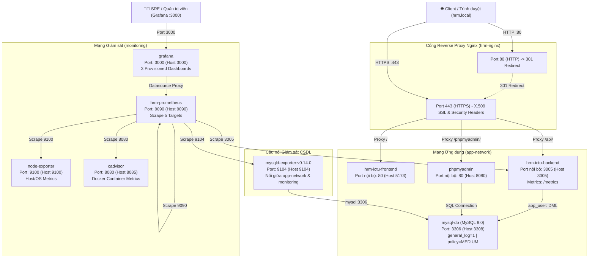

# 🏢 HỆ THỐNG QUẢN LÝ NHÂN SỰ (HRM - ICTU)
### DỰ ÁN BÀI TẬP LỚN / ĐỒ ÁN MÔN HỌC: TRIỂN KHAI VÀ QUẢN TRỊ HỆ THỐNG PHẦN MỀM (K23)
**Khoa Công nghệ Thông tin — Trường Đại học Công nghệ Thông tin & Truyền thông (ICTU)**

[](file:///d:/QLNS_QLTKPM/compose.yaml)
[](file:///d:/QLNS_QLTKPM/backend/package.json)
[](file:///d:/QLNS_QLTKPM/nginx/conf.d/hrm.conf)
[](file:///d:/QLNS_QLTKPM/database/init.sql)
[](file:///d:/QLNS_QLTKPM/prometheus/prometheus.yml)
[](file:///d:/QLNS_QLTKPM/monitoring/grafana)
[-success)](file:///d:/QLNS_QLTKPM/backend/tests)
[](file:///d:/QLNS_QLTKPM/docs/SPRINT_2_BACKLOG.md)

---

## 📌 1. TỔNG QUAN HỆ THỐNG

Hệ thống Quản lý Nhân sự (**HRM - Human Resource Management**) là nền tảng quản trị nguồn nhân lực doanh nghiệp được thiết kế theo kiến trúc **Monorepo** hiện đại, kết hợp chặt chẽ giữa **Frontend Single Page Application (SPA)**, **Backend RESTful API**, **MySQL 8.0**, công cụ quản trị **phpMyAdmin**, cổng giao tiếp bảo mật **Nginx Reverse Proxy HTTPS**, cùng hệ thống giám sát toàn diện **Prometheus & Grafana (Commit 2)**.

Hệ thống đáp ứng trọn vẹn các yêu cầu chuẩn hóa trong học phần **Triển khai và Quản trị Hệ thống Phần mềm (TKQT HTPM)**, hoàn thành xuất sắc cả hai cột mốc **Commit 1** và **Commit 2**:
1. **Container hóa Docker Compose:** Điều phối 10 container dịch vụ độc lập với kiến trúc phân tầng 2 mạng Docker: `app-network` và `monitoring`.
2. **Cơ sở dữ liệu an toàn:** Phân quyền Least Privilege (`app_user`, `report_user`), bật `general_log = 1`, kích hoạt chính sách mật khẩu mức `MEDIUM`.
3. **Bảo mật dữ liệu định danh:** Mã hóa số Căn cước công dân (CCCD) bằng thuật toán chuẩn `AES-256` của MySQL, kiểm tra tính duy nhất bằng `HMAC-SHA-256`, và bảo vệ mật khẩu bằng Bcrypt 10 rounds với chính sách >= 12 ký tự.
4. **Nginx Reverse Proxy HTTPS:** Lắng nghe cổng 80 (tự động chuyển hướng 301 sang HTTPS) và cổng 443 với chứng chỉ số X.509 RSA 2048-bit cho domain nội bộ `hrm.local`.
5. **Bộ Security Headers chuẩn OWASP / DevSecOps:** Chống Clickjacking (`X-Frame-Options: SAMEORIGIN`), chống MIME sniffing (`X-Content-Type-Options: nosniff`), `Referrer-Policy`, `Permissions-Policy`, và `Content-Security-Policy`.
6. **Hạ tầng Giám sát Observability (Mốc Commit 2):** Thu thập metrics tự động qua **Prometheus** với đủ 5 targets (`prometheus`, `node-exporter`, `cadvisor`, `mysql-exporter`, `hrm-app`), kết nối trực tiếp đến **Grafana** hiển thị trực quan qua 3 Dashboards: Node Exporter Full (1860), Docker cAdvisor (14282), MySQL Overview (7362).

---

## 🏗️ 2. KIẾN TRÚC ĐIỀU PHỐI CONTAINER (DOCKER COMPOSE)

Hệ thống được đóng gói và vận hành qua tệp [compose.yaml](file:///d:/QLNS_QLTKPM/compose.yaml) với **10 container dịch vụ** chia thành 2 phân vùng mạng độc lập:



### Bảng phân bổ cổng dịch vụ (10 Containers)

| Dịch vụ | Tên Container | Cổng Host | Cổng Container | Network | Giao thức / Mục đích |
| :--- | :--- | :---: | :---: | :---: | :--- |
| **Nginx HTTPS Gateway** | `hrm-nginx` | **`80` / `443`** | `80` / `443` | `app-network` | Cổng vào duy nhất: Tự động chuyển hướng HTTP $\rightarrow$ HTTPS, SSL và Security Headers |
| **Frontend Web SPA** | `hrm-ictu-frontend` | `5173` | `80` | `app-network` | Giao diện quản lý nhân sự SPA Nginx (alias nội bộ `hrm-app`) |
| **Backend API Service** | `hrm-ictu-backend` | `3005` | `3005` | `app-network`, `monitoring` | RESTful API Express, xác thực JWT, AES-256 CCCD, endpoint `/metrics` |
| **phpMyAdmin** | `phpmyadmin` | `8080` | `80` | `app-network` | Quản trị CSDL MySQL trực quan |
| **MySQL Database** | `mysql-db` | `3308` | `3306` | `app-network` | CSDL MySQL 8.0 lưu trữ bền vững trên Named Volume `mysql_data` |
| **MySQL Exporter** | `mysqld-exporter` | `9104` | `9104` | `app-network`, `monitoring` | Thu thập chỉ số CSDL MySQL (v0.14.0) mở cho Prometheus |
| **cAdvisor** | `cadvisor` | `8085` | `8080` | `monitoring` | Thu thập metrics container Docker (CPU, RAM, Network I/O) |
| **Node Exporter** | `node-exporter` | `9100` | `9100` | `monitoring` | Thu thập metrics tài nguyên máy chủ OS (CPU, Disk, Memory) |
| **Prometheus** | `hrm-prometheus` | `9090` | `9090` | `monitoring` | Máy chủ lưu trữ TSDB và scrape 5 targets định kỳ |
| **Grafana** | `grafana` | `3000` | `3000` | `monitoring` | Nền tảng trực quan hóa số liệu với 3 dashboards tự động provisioning |

---

## 🔑 3. TÀI KHOẢN MẪU & ĐĂNG NHẬP HỆ THỐNG

### 3.1. Tài khoản Người dùng Ứng dụng (RBAC)
Đăng nhập tại: **`https://hrm.local`** (hoặc `http://localhost:5173` khi test dev)

| Tên đăng nhập | Mật khẩu | Vai trò (Role) | Thẩm quyền & Phạm vi truy cập |
| :--- | :--- | :---: | :--- |
| **`admin`** | **`Admin@123`** | **Admin** | **Toàn quyền:** Quản lý cơ cấu phòng ban, thêm/sửa nhân viên, giải mã số CCCD, xem bảng chấm công toàn công ty & chỉ số KPI tổng thể. |
| **`hr`** | **`Hr@123`** | **HR** | **Quản lý Nhân sự:** Quản lý danh sách nhân sự, phòng ban, giải mã số CCCD, theo dõi chấm công toàn công ty. |
| **`emp1`** | **`Emp@123`** | **Employee** | **Nhân viên:** Giao diện Tổng quan cá nhân hóa (Widget Chấm công thời gian thực, Thẻ Số ngày công tích lũy, Thẻ Hồ sơ cá nhân; tự động ẩn toàn bộ chỉ số công ty). |

### 3.2. Tài khoản Cơ sở dữ liệu & phpMyAdmin
Đăng nhập tại: **`https://hrm.local/phpmyadmin/`** (Server: `mysql-db`)

| Tài khoản | Mật khẩu | Quyền hạn (Privileges) | Mục đích sử dụng |
| :--- | :--- | :--- | :--- |
| **`root`** | `RootPassword@2026` | `ALL PRIVILEGES` | Quản trị tối cao CSDL, cấu hình server |
| **`app_user`** | `AppUser@Pass2026` | `SELECT, INSERT, UPDATE, DELETE` trên `hrm_db` | Tài khoản Runtime dành riêng cho Backend Express API (Least Privilege, không có quyền phá hủy DDL) |
| **`report_user`** | `ReportUser@Pass2026` | `SELECT` trên `hrm_db`.* | Tài khoản chỉ đọc (Read-only) phục vụ trích xuất báo cáo, phân tích số liệu |

### 3.3. Tài khoản Giám sát Observability (Grafana & Prometheus - Mốc Commit 2)
Đăng nhập Grafana tại: **`http://localhost:3000`**

| Hệ thống | Đường dẫn / Cổng | Tài khoản | Mật khẩu | Tính năng & Tài nguyên |
| :--- | :--- | :---: | :---: | :--- |
| **Grafana Portal** | `http://localhost:3000` | **`admin`** | **`Admin@Pass2026`** | Quản lý 3 Dashboards: Node Exporter Full (1860), Docker cAdvisor (14282), MySQL Overview (7362) |
| **Prometheus Server** | `http://localhost:9090` | *(Không mật khẩu)* | *(Nội bộ)* | Trực tiếp đối soát 5 Targets UP: `prometheus`, `node-exporter`, `cadvisor`, `mysql-exporter`, `hrm-app` |

---

## 🛡️ 4. BẢO MẬT HỆ THỐNG (DEVSECOPS STANDARDS)

### A. Mã hóa số Căn cước công dân (CCCD) bằng AES-256 (Lab 6)
- **Mã hóa khi lưu:** Số CCCD được mã hóa bằng hàm MySQL `AES_ENCRYPT(?, @AES_KEY)` lưu vào cột nhị phân `ssn_encrypted VARBINARY(255)`.
- **Chống trùng lặp an toàn:** Sử dụng mã băm `HMAC-SHA-256` lưu tại cột `ssn_hash VARCHAR(64)` có chỉ mục `UNIQUE`, cho phép kiểm tra trùng lặp tức thì mà **không cần giải mã toàn bộ bảng**.
- **Che mờ hiển thị:** Cột `ssn_masked VARCHAR(20)` lưu định dạng an toàn (ví dụ: `0382******34`) phục vụ hiển thị công khai.
- **Giải mã có thẩm quyền:** Chỉ người dùng có vai trò `Admin` hoặc `HR` mới được giải mã CCCD qua API `GET /api/employees/:id` bằng hàm MySQL `AES_DECRYPT()`. Danh sách nhân sự (`GET /api/employees`) tuyệt đối **không trả về số CCCD rõ hay ciphertext**.

### B. Chứng chỉ số X.509 SSL & Cấu hình Nginx HTTPS
- Chứng chỉ tự ký định dạng **X.509 RSA 2048-bit**, thuật toán băm `SHA-256`, thời hạn 365 ngày.
- Bổ sung trường mở rộng **Subject Alternative Name (SAN)**: `DNS:hrm.local, DNS:localhost, IP:127.0.0.1`.
- Cấu hình Nginx hỗ trợ giao thức bảo mật cao `TLSv1.2` và `TLSv1.3`.

### C. Bộ Security Headers chuẩn OWASP (Lab 1 & Lab 5)
Hệ thống Nginx được cấu hình snippet [nginx/conf.d/security_headers.inc](file:///d:/QLNS_QLTKPM/nginx/conf.d/security_headers.inc):
```nginx
add_header X-Frame-Options "SAMEORIGIN" always;
add_header X-Content-Type-Options "nosniff" always;
add_header X-XSS-Protection "1; mode=block" always;
add_header Referrer-Policy "strict-origin-when-cross-origin" always;
add_header Permissions-Policy "camera=(), microphone=(), geolocation=()" always;
add_header X-Permitted-Cross-Domain-Policies "none" always;
```
- **X-Frame-Options: SAMEORIGIN**: Chống tấn công Clickjacking / UI Redressing.
- **X-Content-Type-Options: nosniff**: Chống tấn công MIME sniffing.
- **proxy_hide_header**: Ẩn header `X-Powered-By` (Express, PHP) nhằm chống rò rỉ phiên bản phần mềm máy chủ; loại bỏ header trùng lặp từ upstream.
- **Content-Security-Policy (CSP)**: Thiết lập an toàn cho Frontend SPA, cho phép nạp tài nguyên hợp lệ và Google Fonts.

---

## 🚀 5. HƯỚNG DẪN CÀI ĐẶT VÀ VẬN HÀNH

### 5.1. Yêu cầu môi trường
- **Docker Desktop** (hỗ trợ Docker Compose v2).
- **Git** client.
- **Node.js** >= 18.x (nếu muốn chạy bộ test tại máy host).

### 5.2. Cấu hình phân giải Domain nội bộ (`hrm.local`)
Để truy cập được tên miền `https://hrm.local` trên trình duyệt máy bạn:

**Trên Windows:**
1. Mở Notepad bằng quyền Administrator (Run as Administrator).
2. Mở file: `C:\Windows\System32\drivers\etc\hosts`.
3. Thêm dòng sau vào cuối file và lưu lại:
   ```text
   127.0.0.1 hrm.local
   ```

**Trên Linux / macOS:**
```bash
sudo echo "127.0.0.1 hrm.local" >> /etc/hosts
```

### 5.3. Khởi chạy toàn bộ hệ thống bằng Docker Compose

```powershell
# 1. Sao chép file cấu hình biến môi trường
copy .env.example .env

# 2. Khởi chạy và build toàn bộ 5 dịch vụ container
docker compose up -d --build

# 3. Kiểm tra trạng thái các container
docker compose ps
```

*Kỳ vọng đầu ra:*
```text
NAME                IMAGE                   STATUS                  PORTS
hrm-nginx           nginx:alpine            Up (healthy)            0.0.0.0:80->80/tcp, 0.0.0.0:443->443/tcp
hrm-ictu-frontend   qlns_qltkpm-frontend    Up (healthy)            0.0.0.0:5173->80/tcp
hrm-ictu-backend    qlns_qltkpm-backend     Up (healthy)            0.0.0.0:3005->3005/tcp
phpmyadmin          phpmyadmin:5.2.1        Up (healthy)            0.0.0.0:8080->80/tcp
mysql-db            mysql:8.0               Up (healthy)            0.0.0.0:3308->3306/tcp
```

### 5.4. Dừng hệ thống an toàn (Bảo toàn dữ liệu)
```powershell
# Dừng container an toàn (dữ liệu MySQL vẫn nguyên vẹn)
docker compose down

# ⚠️ CẢNH BÁO: TUYỆT ĐỐI KHÔNG dùng 'docker compose down -v' vì sẽ xóa sạch volume dữ liệu!
```

---

## 🧪 6. KIỂM THỬ TỰ ĐỘNG (AUTOMATED TEST SUITES)

Dự án sở hữu bộ kiểm thử tự động toàn diện với **362+ bài kiểm thử (100% PASS)**:

```powershell
# 1. Chạy bộ kiểm thử tích hợp E2E toàn bộ chức năng Sprint 2 trên Docker Compose (41 kịch bản)
cd backend
npm run test:e2e:sprint2

# 2. Chạy bộ kiểm thử tích hợp đầu cuối E2E qua HTTPS của Sprint 1 (32 kịch bản)
npm run test:e2e:https

# 3. Chạy toàn bộ Unit & Security Test Suites của Backend (119 bài kiểm thử)
npm test

# 4. Chạy kiểm toán chuyên sâu hạ tầng giám sát Prometheus 5/5 Targets & Grafana Realtime
npm run test:qa:monitoring:realtime

# 5. Chạy toàn bộ Test Suites của Frontend SPA (101 bài kiểm thử)
cd ../frontend
npm test
```

### Chi tiết các bộ test:
1. **Sprint 2 E2E Integration Suite (`npm run test:e2e:sprint2` - 41 kịch bản):**
   - **Hạ tầng Multi-tier:** Kiểm tra sức khỏe 10 containers qua Docker internal networks (`app-network` và `monitoring`).
   - **US 3.0 (Đổi mật khẩu):** Kiểm tra ranh giới độ dài >= 12 ký tự, băm Bcrypt 10 rounds, chặn mật khẩu cũ, vô hiệu hóa token cũ, đăng nhập lại thành công.
   - **US 7.0 (Phòng ban):** Cập nhật phòng ban qua API PUT, đối soát đồng bộ CSDL.
   - **US 13.0 & 14.0 (Nhân sự & Thôi việc):** Cập nhật hồ sơ, giải mã bảo toàn số CCCD AES-256 nguyên vẹn, thôi việc soft-delete chuyển `Resigned` và tự động khóa user `Locked`.
   - **US 19.0 (Lịch sử công):** Bảng lịch sử chấm công theo tháng, tính tổng ngày công, đi muộn, về sớm theo chuẩn múi giờ Việt Nam.
   - **US 22.0 (Xuất báo cáo):** Xuất báo cáo Excel (`.xlsx` với binary ZIP PK signature) và CSV (`.csv` với UTF-8 Byte Order Mark chống lỗi font tiếng Việt).
   - **US 20.0 (Dashboard):** KPI nhân sự (tổng NV, đi làm hôm nay, tỷ lệ %) và phân bổ phòng ban đối chiếu 100% database.
   - **US 29.0 (Observability):** 5/5 targets Prometheus đạt trạng thái `UP`, Grafana Datasource Proxy phân giải DNS thành công, nạp 3 dashboards tự động và truy vấn realtime.
2. **E2E HTTPS Integration Test (`npm run test:e2e:https` - 32 tests):**
   - Bắt tay TLS, kiểm tra X.509 cert, 6 Security Headers và CSP.
   - Luồng Đăng nhập, giải mã JWT, phân quyền 3 vai trò Admin / HR / Employee.
   - CRUD Nhân sự, mã hóa AES-256 CCCD, bắt lỗi trùng mã NV (409) và trùng CCCD (409).
   - Chấm công: Check-in, Check-out, chống chấm công trùng lặp trong ngày (409).
3. **Backend Test Suite (`npm test` - 119 tests):**
   - `test:auth`: Bcrypt băm mật khẩu, đăng nhập, JWT expiry & signature.
   - `test:rbac`: Middleware phân quyền truy cập và bảo vệ dữ liệu.
   - `test:department`: CRUD phòng ban và ràng buộc xóa.
   - `test:employee`: Thêm mới, phân trang, giải mã CCCD AES-256.
   - `test:attendance`: Mốc biên thời gian 08:30:00, OnTime/Late, Today board.
   - `test:db`: Schema, Least Privilege của `app_user` & `report_user`, Lab 6 `general_log` và Password Policy `MEDIUM`.
4. **Frontend Test Suite (`npm test` - 101 tests):**
   - UI Dashboard cá nhân hóa cho Employee (ẩn chỉ số công ty).
   - Widget Chấm công thời gian thực và Bảng chấm công hôm nay.
   - Modal thêm/sửa nhân viên, Modal đổi mật khẩu cá nhân có thang đo độ mạnh.
   - Bảng lịch sử công theo tháng và nút xuất báo cáo Excel/CSV.

---

## 🏁 7. RÀ SOÁT TIÊU CHÍ DEFINITION OF DONE

### 7.1. Cột mốc Commit 1 (Sprint 1)
Theo [docs/SPRINT_1_BACKLOG.md](file:///d:/QLNS_QLTKPM/docs/SPRINT_1_BACKLOG.md), toàn bộ 8 tiêu chí nghiệm thu của Sprint 1 đã hoàn thành xuất sắc:
- [x] **DoD 1:** Lệnh `docker compose up -d` khởi động thành công cả 5 container cốt lõi.
- [x] **DoD 2:** Container `mysql-db` đạt trạng thái `(healthy)`.
- [x] **DoD 3:** Truy cập `http://hrm.local` tự động chuyển hướng 301 sang `https://hrm.local` với chứng chỉ SSL và bộ Security Headers chuẩn DevSecOps.
- [x] **DoD 4:** Đăng nhập thành công với 3 tài khoản mẫu: `admin`, `hr`, `emp1`.
- [x] **DoD 5:** Thêm mới nhân viên, số CCCD được mã hóa bằng MySQL `AES_ENCRYPT`, kiểm tra tính duy nhất bằng `ssn_hash` (HMAC-SHA-256), giải mã chuẩn xác khi có thẩm quyền.
- [x] **DoD 6:** Thực hiện Check-in / Check-out và xem bảng chấm công thời gian thực theo phân quyền RBAC.
- [x] **DoD 7:** Truy cập thành công trang quản trị CSDL phpMyAdmin tại `https://hrm.local/phpmyadmin/`.
- [x] **DoD 8:** Hoàn tất **Commit số 1** lên GitHub:  
  `feat(core): deploy hrm application, mysql 8.0, phpmyadmin and nginx reverse proxy with https and security headers`

### 7.2. Cột mốc Commit 2 (Sprint 2)
Theo [docs/SPRINT_2_BACKLOG.md](file:///d:/QLNS_QLTKPM/docs/SPRINT_2_BACKLOG.md), toàn bộ 9 tiêu chí nghiệm thu của Sprint 2 đã hoàn thành xuất sắc:
- [x] **DoD 1:** Chỉnh sửa phòng ban (`US 7.0`), cập nhật hồ sơ nhân sự (`US 13.0`), bảo toàn dữ liệu CCCD AES-256 và thôi việc soft-delete (`US 14.0`) vận hành trơn tru.
- [x] **DoD 2:** Lịch sử chấm công theo tháng (`US 19.0`) tính công chuẩn xác và xuất báo cáo Excel/CSV chuẩn UTF-8 BOM (`US 22.0`).
- [x] **DoD 3:** Dashboard thống kê tổng quan (`US 20.0`) hiển thị đúng số liệu thực tế từ database và biểu đồ phân bổ phòng ban trực quan.
- [x] **DoD 4:** Đổi mật khẩu cá nhân (`US 3.0`) với độ phức tạp >= 12 ký tự, băm Bcrypt, vô hiệu hóa mật khẩu cũ tức thì và đăng nhập lại thành công.
- [x] **DoD 5:** Hệ thống Docker Compose vận hành trơn tru kiến trúc mạng đa tầng (`app-network` và `monitoring`) với 10 containers khỏe mạnh.
- [x] **DoD 6:** Menu **Prometheus Status $\rightarrow$ Targets**: Đủ 5/5 targets đạt trạng thái xanh **`UP`** (`prometheus`, `node-exporter`, `cadvisor`, `mysql-exporter`, `hrm-app`).
- [x] **DoD 7:** **Grafana (cổng 3000)**: Tự động có sẵn Datasource Prometheus qua provisioning và hiển thị trực quan dữ liệu thời gian thực trên 3 Dashboards:
  - *Node Exporter Full (ID: 1860)*
  - *cAdvisor Docker Monitoring (ID: 14282)*
  - *MySQL Overview (ID: 7362)*
- [x] **DoD 8:** Bộ kiểm thử tích hợp tự động E2E Sprint 2 (`npm run test:e2e:sprint2`) vượt qua **41/41 kịch bản (100% PASS)**, đảm bảo zero regression trên toàn bộ hệ thống.
- [x] **DoD 9:** Repository GitHub hoàn tất **Commit mốc số 2** với commit message chuẩn mực:  
  `feat(monitoring): integrate prometheus, grafana dashboards, mysql-exporter, cadvisor, and node-exporter with dual-network architecture`

---

## 👥 8. THÀNH VIÊN DỰ ÁN

- **Nhóm sinh viên K23** — Học phần Triển khai và Quản trị Hệ thống Phần mềm (TKQT HTPM).
- **Đề tài:** Đề 10 - Hệ thống Quản lý Nhân sự (HRM).
- **Khoa Công nghệ Thông tin — Trường Đại học Công nghệ Thông tin & Truyền thông (ICTU).**

---
*Bản quyền tài liệu thuộc về Nhóm Phát triển Đề tài 10 (HRM - ICTU) | Tháng 10/2026.*
