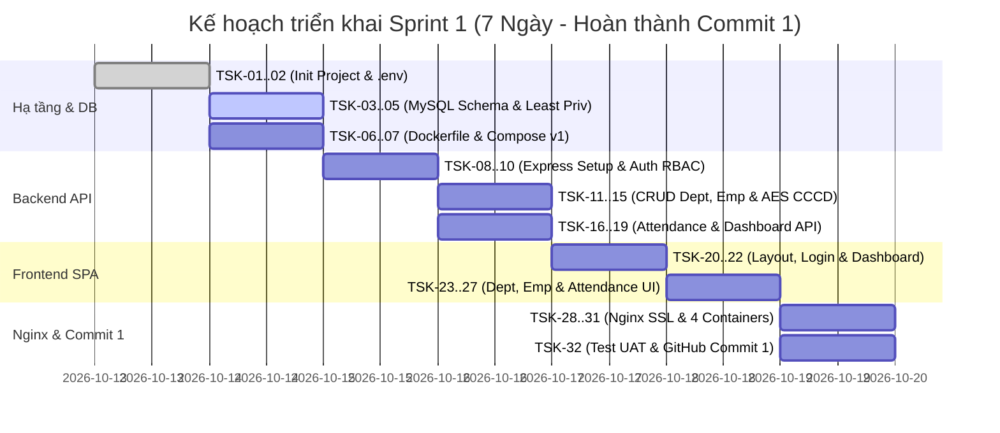

# 🚀 SPRINT 1 BACKLOG & KẾ HOẠCH TRIỂN KHAI CHI TIẾT
**Học phần:** Triển khai và Quản trị Hệ thống Phần mềm (TKQT HTPM K23)  
**Đề tài:** Đề 10 - Hệ thống Quản lý Nhân sự (HRM)  
**Mục tiêu Sprint 1:** Hoàn thành toàn bộ ứng dụng HRM, CSDL MySQL 8.0, phpMyAdmin, Nginx HTTPS tự ký $\rightarrow$ **Cán mốc Commit 1 trên GitHub**  
**Thời lượng Sprint:** Tuần 1  
**Quy mô:** 20 User Stories | 32 Technical Tasks | 59 Story Points (~42 Giờ phát triển)  
**Phiên bản:** 1.0.0 | **Ngày lập:** 13/10/2026  

---

## 🎯 1. MỤC TIÊU CỐT LÕI CỦA SPRINT 1 (SPRINT GOAL)
Xây dựng thành công hệ sinh thái ứng dụng Quản lý Nhân sự gồm 4 container Docker phối hợp:
1. **Container `mysql-db` (MySQL 8.0):** Khởi tạo schema `hrm_db`, phân quyền Least Privilege (`app_user` và `report_user`), mã hóa cột CCCD bằng `AES_ENCRYPT`, lưu nhật ký truy vấn (`general_log = 1`).
2. **Container `hrm-app` (Web Application):** Chạy ứng dụng HRM (Frontend SPA + Backend Express API), chạy dưới quyền **non-root user**, cung cấp 16 REST API đầy đủ nghiệp vụ.
3. **Container `phpmyadmin` (phpMyAdmin 5.x):** Công cụ quản trị CSDL trực quan kết nối an toàn với MySQL.
4. **Container `nginx` (Nginx Reverse Proxy):** Lắng nghe port 80 và 443, tự động chuyển hướng HTTP $\rightarrow$ HTTPS, phục vụ chứng chỉ SSL tự ký cho domain `https://hrm.local`, thiết lập đầy đủ Security Headers.
5. **Cột mốc GitHub:** Thực hiện thành công **Commit 1** theo đúng barem giảng viên yêu cầu (đạt 4.5/10 điểm của Tiêu chí 1, 2, 3).

---

## 📋 2. DANH SÁCH USER STORIES THUỘC SPRINT 1 (20 STORIES - 59 SP)

| Mã US | Tên User Story | Priority | SP | Thành phần kỹ thuật | Mốc Commit |
| :---: | :--- | :---: | :---: | :--- | :---: |
| **US-01** | Đăng nhập hệ thống bằng JWT & bcrypt | **P0** | 3 | Backend API + Frontend Modal | Commit 1 |
| **US-02** | Phân quyền truy cập RBAC (Admin/HR/Employee) | **P0** | 3 | Auth Middleware | Commit 1 |
| **US-03** | Đăng xuất & Quản lý phiên làm việc | **P1** | 1 | Client State Management | Commit 1 |
| **US-04** | Xem danh sách phòng ban & số lượng nhân sự | **P0** | 2 | Department Controller & UI Table | Commit 1 |
| **US-05** | Thêm mới phòng ban (Validation mã duy nhất) | **P0** | 2 | Department Form Modal | Commit 1 |
| **US-06** | Chỉnh sửa & Xóa phòng ban (Ràng buộc dữ liệu) | **P1** | 2 | Department Action Controller | Commit 1 |
| **US-07** | Xem danh sách nhân viên có phân trang & bộ lọc | **P0** | 3 | Employee Controller & UI Table | Commit 1 |
| **US-08** | Thêm mới nhân sự & Mã hóa CCCD (AES_ENCRYPT) | **P0** | 5 | Employee Model & AES Service | Commit 1 |
| **US-09** | Xem chi tiết & Giải mã số CCCD có thẩm quyền | **P0** | 3 | Employee Details Modal | Commit 1 |
| **US-10** | Cập nhật hồ sơ & Chuyển trạng thái thôi việc | **P1** | 2 | Employee Edit & Soft-delete | Commit 1 |
| **US-11** | Nhân viên Check-in vào ca hàng ngày (OnTime/Late)| **P0** | 3 | Attendance Controller & Check-in UI | Commit 1 |
| **US-12** | Nhân viên Check-out kết thúc ca làm | **P0** | 2 | Attendance Check-out Logic | Commit 1 |
| **US-13** | Bảng theo dõi chấm công hôm nay (Daily View) | **P0** | 3 | Attendance Daily Dashboard | Commit 1 |
| **US-14** | Lịch sử chấm công theo tháng & Thống kê công | **P1** | 3 | Attendance Monthly History UI | Commit 1 |
| **US-15** | Dashboard thống kê tổng quan (Executive KPI) | **P0** | 3 | Dashboard Controller & Chart | Commit 1 |
| **US-16** | Khởi tạo CSDL MySQL & Phân quyền Least Privilege | **P0** | 5 | SQL Script `database/init.sql` | Commit 1 |
| **US-17** | Đóng gói ứng dụng Docker Compose & Healthcheck | **P0** | 5 | Dockerfile + docker-compose.yml | Commit 1 |
| **US-18** | Triển khai công cụ quản trị phpMyAdmin | **P0** | 2 | Docker Compose Service | Commit 1 |
| **US-19** | Cấu hình Nginx Reverse Proxy & Domain `hrm.local`| **P0** | 3 | Nginx Conf & Hosts mapping | Commit 1 |
| **US-20** | Cấu hình HTTPS tự ký, Security Headers & Commit 1 | **P0** | 3 | OpenSSL Script + Git Commit 1 | Commit 1 |

---

## 🛠️ 3. BẢNG PHÂN RÃ CÔNG VIỆC KỸ THUẬT (TASK BREAKDOWN - 32 TASKS)

### PHẦN A: HẠ TẦNG DỰ ÁN & CƠ SỞ DỮ LIỆU (DATABASE & DOCKER BASE)
| Task ID | Mã US | Tên nhiệm vụ cụ thể | File thực hiện | Ước lượng | Trạng thái |
| :---: | :---: | :--- | :--- | :---: | :---: |
| **TSK-01** | - | Khởi tạo cấu trúc thư mục dự án (`app/`, `database/`, `nginx/`, `monitoring/`) | Toàn project | 0.5h | To Do |
| **TSK-02** | - | Thiết lập file biến môi trường `.env` và `.env.example` chứa các mật khẩu bảo mật | `.env`, `.env.example` | 0.5h | To Do |
| **TSK-03** | US-16 | Soạn thảo DDL Schema: Bảng `departments`, `employees`, `attendances`, `users` | `database/init.sql` | 1.5h | To Do |
| **TSK-04** | US-16 | Thiết lập phân quyền Least Privilege: User `app_user` và `report_user` | `database/init.sql` | 1.0h | To Do |
| **TSK-05** | US-08 | Viết seed data mẫu: 3 phòng ban, 5 nhân viên mã hóa CCCD, 3 tài khoản user, chấm công | `database/init.sql` | 1.0h | To Do |
| **TSK-06** | US-17 | Viết `Dockerfile` cho ứng dụng HRM với user **non-root** (`USER node`) | `app/Dockerfile` | 1.0h | To Do |
| **TSK-07** | US-17, 18 | Viết `docker-compose.yml` định nghĩa service `mysql-db` (kèm Healthcheck) & `phpmyadmin` | `docker-compose.yml` | 1.5h | To Do |

### PHẦN B: PHÁT TRIỂN BACKEND REST API (NODE.JS / EXPRESS)
| Task ID | Mã US | Tên nhiệm vụ cụ thể | File thực hiện | Ước lượng | Trạng thái |
| :---: | :---: | :--- | :--- | :---: | :---: |
| **TSK-08** | - | Khởi tạo dự án Node.js, cài đặt dependencies (`express`, `mysql2`, `bcryptjs`, `jsonwebtoken`, `cors`, `dotenv`) | `app/package.json` | 0.5h | To Do |
| **TSK-09** | - | Xây dựng module kết nối MySQL Connection Pool với xử lý reconnect tự động | `app/backend/config/db.js` | 1.0h | To Do |
| **TSK-10** | US-01, 02 | Xây dựng Middleware xác thực JWT Token và Middleware kiểm tra quyền RBAC | `app/backend/middleware/auth.js` | 1.5h | To Do |
| **TSK-11** | US-01, 03 | Xây dựng API Đăng nhập (`POST /api/auth/login`) và Xem profile (`GET /api/auth/profile`) | `app/backend/controllers/authController.js` | 1.5h | To Do |
| **TSK-12** | US-04, 05, 06 | Xây dựng CRUD API Quản lý Phòng ban (`GET, POST, PUT, DELETE /api/departments`) | `app/backend/controllers/departmentController.js` | 2.0h | To Do |
| **TSK-13** | US-07, 10 | Xây dựng API Danh sách & Cập nhật Nhân viên (`GET, PUT, DELETE /api/employees`) | `app/backend/controllers/employeeController.js` | 2.0h | To Do |
| **TSK-14** | US-08 | Xây dựng API Thêm mới nhân sự với mã hóa CCCD bằng `AES_ENCRYPT` trong câu lệnh SQL | `app/backend/controllers/employeeController.js` | 2.0h | To Do |
| **TSK-15** | US-09 | Xây dựng API Xem chi tiết giải mã CCCD bằng `AES_DECRYPT` (kiểm tra quyền Admin/HR) | `app/backend/controllers/employeeController.js` | 1.5h | To Do |
| **TSK-16** | US-11, 12 | Xây dựng API Check-in và Check-out với logic tính toán OnTime/Late/EarlyLeave | `app/backend/controllers/attendanceController.js` | 2.0h | To Do |
| **TSK-17** | US-13, 14 | Xây dựng API Chấm công hôm nay & Lịch sử chấm công theo tháng | `app/backend/controllers/attendanceController.js` | 1.5h | To Do |
| **TSK-18** | US-15 | Xây dựng API Thống kê số liệu Dashboard (`GET /api/dashboard/stats`) | `app/backend/controllers/dashboardController.js` | 1.5h | To Do |
| **TSK-19** | - | Xây dựng Endpoint Healthcheck (`GET /health`) kiểm tra kết nối CSDL và Server | `app/backend/server.js` | 0.5h | To Do |

### PHẦN C: PHÁT TRIỂN GIAO DIỆN FRONTEND (SINGLE PAGE APPLICATION)
| Task ID | Mã US | Tên nhiệm vụ cụ thể | File thực hiện | Ước lượng | Trạng thái |
| :---: | :---: | :--- | :--- | :---: | :---: |
| **TSK-20** | - | Thiết kế khung sườn giao diện SPA (Layout, Sidebar điều hướng, Header, Toast message) | `app/frontend/index.html`, `style.css` | 2.0h | To Do |
| **TSK-21** | US-01, 03 | Xây dựng màn hình Đăng nhập (Validation form, lưu token, thông báo đăng nhập sai) | `app/frontend/js/auth.js` | 1.5h | To Do |
| **TSK-22** | US-15 | Xây dựng màn hình Tổng quan (3 thẻ thống kê KPI, biểu đồ nhân sự phòng ban) | `app/frontend/js/dashboard.js` | 2.0h | To Do |
| **TSK-23** | US-04, 05, 06 | Xây dựng màn hình Phòng ban (Bảng danh sách, Modal thêm/sửa, xác nhận xóa) | `app/frontend/js/departments.js` | 2.0h | To Do |
| **TSK-24** | US-07, 10 | Xây dựng màn hình Nhân viên (Bảng dữ liệu, tìm kiếm, lọc phòng ban, phân trang) | `app/frontend/js/employees.js` | 2.5h | To Do |
| **TSK-25** | US-08, 09 | Xây dựng Modal Thêm/Sửa nhân viên và Modal Xem chi tiết hồ sơ giải mã số CCCD | `app/frontend/js/employees.js` | 2.0h | To Do |
| **TSK-26** | US-11, 12 | Xây dựng Widget Chấm công trực tiếp (Đồng hồ số thời gian thực, nút Check-in/out) | `app/frontend/js/attendance.js` | 1.5h | To Do |
| **TSK-27** | US-13, 14 | Xây dựng Bảng chấm công hôm nay và Bảng lịch sử chấm công theo tháng | `app/frontend/js/attendance.js` | 2.0h | To Do |

### PHẦN D: NGINX REVERSE PROXY, HTTPS & HOÀN THIỆN COMMIT 1
| Task ID | Mã US | Tên nhiệm vụ cụ thể | File thực hiện | Ước lượng | Trạng thái |
| :---: | :---: | :--- | :--- | :---: | :---: |
| **TSK-28** | US-20 | Sinh chứng chỉ SSL tự ký X.509 RSA 2048-bit bằng OpenSSL cho domain `hrm.local` | `nginx/ssl/hrm.local.crt`, `.key` | 1.0h | To Do |
| **TSK-29** | US-19, 20 | Cấu hình Nginx: Chuyển hướng HTTP $\rightarrow$ HTTPS, Reverse proxy `/` và `/phpmyadmin/` | `nginx/nginx.conf` | 1.5h | To Do |
| **TSK-30** | US-20 | Bổ sung đầy đủ Nginx Security Headers (`X-Frame-Options`, `X-Content-Type-Options`) | `nginx/nginx.conf` | 0.5h | To Do |
| **TSK-31** | US-17, 19 | Tích hợp container `nginx` vào `docker-compose.yml`, kiểm thử khởi động 4 container | `docker-compose.yml` | 1.0h | To Do |
| **TSK-32** | US-20 | Soạn thảo `README.md` hướng dẫn chạy và thực hiện **Commit mốc 1** lên GitHub | `README.md`, Git commit | 1.0h | To Do |

---

## 📅 4. TIẾN ĐỘ THỰC HIỆN TỪNG NGÀY (DAILY SPRINT SCHEDULE)

---

## 🏁 5. TIÊU CHÍ HOÀN THÀNH SPRINT 1 (SPRINT 1 DEFINITION OF DONE)
Để đóng Sprint 1 và chuyển sang Sprint 2 (Monitoring Prometheus/Grafana), toàn bộ các điều kiện sau **phải được kiểm chứng thành công**:

1. [ ] Lệnh `docker compose up -d` khởi động thành công cả 4 container: `mysql-db`, `hrm-app`, `phpmyadmin`, `nginx`.
2. [ ] Container `mysql-db` đạt trạng thái `(healthy)`.
3. [ ] Truy cập `http://hrm.local` tự động chuyển hướng sang `https://hrm.local` với biểu tượng ổ khóa SSL tự ký.
4. [ ] Đăng nhập thành công với 3 tài khoản mẫu:
   - `admin` / `Admin@123` (Toàn quyền)
   - `hr` / `Hr@123` (Quản lý nhân sự)
   - `emp1` / `Emp@123` (Nhân viên)
5. [ ] Thực hiện thêm mới 1 nhân viên, kiểm tra trong phpMyAdmin thấy cột `ssn_encrypted` chứa dữ liệu nhị phân mã hóa (không thấy số CCCD dạng text rõ ràng).
6. [ ] Thực hiện Check-in / Check-out và xem bảng chấm công thời gian thực.
7. [ ] Truy cập được trang quản trị CSDL phpMyAdmin tại đường dẫn `https://hrm.local/phpmyadmin/`.
8. [ ] Repository GitHub có **Commit số 1** với thông điệp rõ ràng:  
   `feat(core): deploy hrm application, mysql 8.0, phpmyadmin and nginx reverse proxy with https and security headers`
