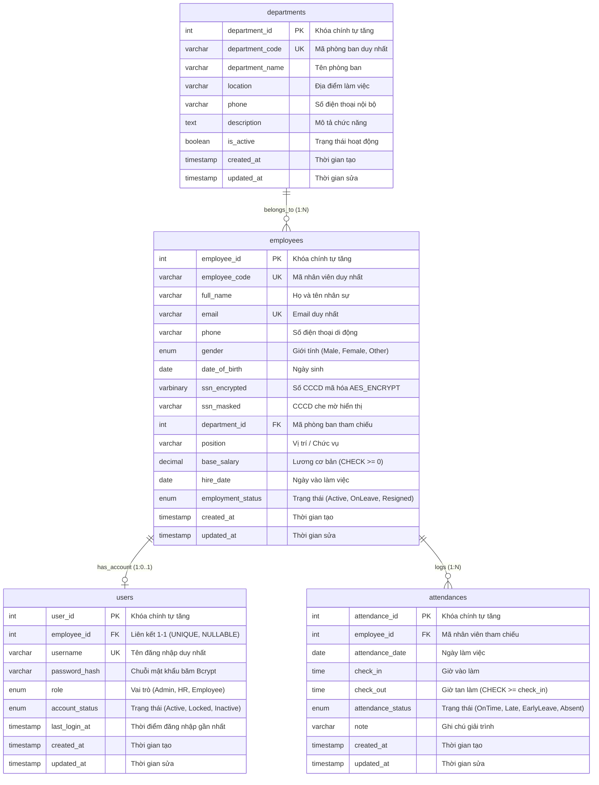

# 📊 TÀI LIỆU THIẾT KẾ ERD DATABASE CHUẨN DOANH NGHIỆP - HỆ THỐNG QUẢN LÝ NHÂN SỰ (HRM)

**Học phần:** Triển khai và Quản trị Hệ thống Phần mềm (TKQT HTPM K23)  
**Đề tài:** Đề 10 - Hệ thống Quản lý Nhân sự (HRM - ICTU)  
**Hệ quản trị CSDL:** MySQL 8.0+ (InnoDB Engine, utf8mb4_unicode_ci)  
**Nhánh Git:** `feature/database-erd`  
**Cập nhật:** 13/10/2026  

---

## 🎯 1. PHÂN TÍCH NGHIỆP VỤ & CÁC GIẢ ĐỊNH (BUSINESS ANALYSIS & ASSUMPTIONS)

### 1.1 Phân tích các quy tắc nghiệp vụ cốt lõi
1. **Phòng ban và Nhân sự (Departments — Employees):**
   - **Quy tắc:** Một phòng ban có thể chứa nhiều nhân viên ($1:N$). 
   - **Giả định:** Mỗi nhân viên khi được tiếp nhận chính thức vào hệ thống phải thuộc về một phòng ban xác định (`department_id INT NOT NULL`). Nếu có trường hợp nhân sự thử việc hoặc thực tập sinh chưa gán phòng ban, doanh nghiệp sẽ bố trí vào phòng ban mặc định *"Phòng Nhân sự & Hành chính"* hoặc *"Ban chờ phân bổ"*, tránh tình trạng dữ liệu mồ côi (orphaned record).
   - **Xử lý ngừng hoạt động:** Khi một phòng ban ngừng hoạt động, hệ thống sử dụng cờ `is_active = FALSE` (Soft-delete) kết hợp ràng buộc `ON DELETE RESTRICT`. Tuyệt đối không cho phép xóa vật lý (Hard-delete) phòng ban khi đang còn nhân sự trực thuộc.

2. **Chấm công nhân viên (Employees — Attendances):**
   - **Quy tắc:** Một nhân viên có nhiều bản ghi chấm công qua các ngày làm việc ($1:N$).
   - **Quy tắc chống trùng lặp:** Hệ thống áp dụng nguyên tắc **1 bản ghi công duy nhất cho mỗi nhân viên trong 1 ngày**. Khóa phức hợp duy nhất `UNIQUE KEY (employee_id, attendance_date)` được thiết lập ở cấp độ CSDL để chặn triệt để tình trạng ghi nhận trùng lặp tại nguồn.
   - **Quy tắc tính toán trạng thái:** 
     - Ca làm việc tiêu chuẩn: $08:00 - 17:30$.
     - `check_in` $\le 08:30$ $\rightarrow$ `OnTime` (Đúng giờ); `check_in` $> 08:30$ $\rightarrow$ `Late` (Đi muộn).
     - `check_out` $< 17:30$ $\rightarrow$ `EarlyLeave` (Về sớm).
     - Ràng buộc kiểm tra: `check_out` phải $\ge$ `check_in` (nếu cả hai cùng có giá trị).

3. **Tài khoản đăng nhập và Nhân viên (Employees — Users):**
   - **Bản chất quan hệ:** $1 : 0..1$ (Một nhân viên có tối đa 1 tài khoản; một tài khoản gắn với tối đa 1 nhân viên).
   - **Lý do chọn quan hệ $1:0..1$ thay vì $1:N$:** Trong hệ thống HRM tiêu chuẩn, mỗi cá nhân nhân sự chỉ có một định danh số duy nhất để đăng nhập cổng thông tin tự phục vụ (Self-service). Việc cho phép $1$ nhân viên có nhiều tài khoản sẽ gây xung đột phiên làm việc, khó truy vết nhật ký kiểm toán (Audit Trail) và dễ dẫn đến sai lệch khi chấm công.
   - **Phân biệt đối tượng người dùng:**
     - Nhân viên chưa có tài khoản: Hồ sơ nằm trong bảng `employees`, chưa có bản ghi tương ứng trong `users`.
     - Nhân viên đã cấp tài khoản: Bản ghi `users` liên kết với `employees.employee_id`.
     - Tài khoản Quản trị viên kỹ thuật (Root/DevOps Admin): Có thể độc lập hoàn toàn với hồ sơ nhân sự (`employee_id = NULL`).

4. **Xử lý nhân sự thôi việc (Off-boarding & Resignation):**
   - Nhân viên thôi việc **không bao giờ bị xóa cứng (`HARD DELETE`)** khỏi CSDL để bảo tồn toàn vẹn dữ liệu lịch sử chấm công, tính lương và chứng từ pháp lý.
   - Thay vào đó, hệ thống áp dụng cơ chế **Soft-delete**:
     - Cập nhật `employees.employment_status = 'Resigned'`.
     - Khóa tài khoản đăng nhập tương ứng `users.account_status = 'Locked'` hoặc `'Inactive'`.

5. **Bảo mật dữ liệu nhân thân & Mật khẩu (Lab 6 / US-08, US-09, US-16):**
   - Số CCCD/CMND là dữ liệu nhạy cảm cao, bắt buộc phải mã hóa bằng thuật toán `AES-256` thông qua hàm `AES_ENCRYPT(ssn, key)` và lưu trong cột `ssn_encrypted VARBINARY(255)`.
   - Cung cấp thêm cột `ssn_masked VARCHAR(20)` (dạng `0380******12`) phục vụ hiển thị công khai trên giao diện danh sách.
   - Mật khẩu người dùng được băm 1 chiều bằng thuật toán `Bcrypt` (Salt rounds = 10), tuyệt đối không lưu plain-text.

---

## 🗂️ 2. DANH SÁCH BẢNG VÀ MÔ TẢ TỔNG QUAN

| STT | Tên bảng | Chức năng nghiệp vụ | Số lượng cột | Khóa chính | Khóa ngoại |
| :---: | :--- | :--- | :---: | :---: | :---: |
| 1 | `departments` | Quản lý cơ cấu phòng ban và tổ chức | 9 | `department_id` | Không |
| 2 | `employees` | Quản lý thông tin hồ sơ nhân sự, mã hóa CCCD | 16 | `employee_id` | `department_id` $\rightarrow$ `departments` |
| 3 | `users` | Quản lý tài khoản đăng nhập và phân quyền RBAC | 9 | `user_id` | `employee_id` $\rightarrow$ `employees` |
| 4 | `attendances` | Quản lý dữ liệu chấm công và điểm danh hàng ngày | 9 | `attendance_id` | `employee_id` $\rightarrow$ `employees` |

---

## 📖 3. TỪ ĐIỂN DỮ LIỆU CHI TIẾT (DATA DICTIONARY)

### 3.1 Bảng `departments` (Phòng ban)

| Tên cột | Kiểu dữ liệu | PK | FK | UK | Nullable | Mặc định | Ý nghĩa nghiệp vụ |
| :--- | :--- | :---: | :---: | :---: | :---: | :--- | :--- |
| `department_id` | `INT` | ✅ | ❌ | ❌ | NOT NULL | AUTO_INCREMENT | Mã định danh phòng ban duy nhất |
| `department_code` | `VARCHAR(20)` | ❌ | ❌ | ✅ | NOT NULL | | Mã phòng ban viết tắt (vd: `PB-TECH`, `PB-HR`) |
| `department_name` | `VARCHAR(100)` | ❌ | ❌ | ❌ | NOT NULL | | Tên phòng ban đầy đủ |
| `location` | `VARCHAR(255)` | ❌ | ❌ | ❌ | NULL | NULL | Địa chỉ văn phòng, số tầng làm việc |
| `phone` | `VARCHAR(20)` | ❌ | ❌ | ❌ | NULL | NULL | Số điện thoại bàn phòng ban |
| `description` | `TEXT` | ❌ | ❌ | ❌ | NULL | NULL | Mô tả nhiệm vụ, chức năng |
| `is_active` | `BOOLEAN` | ❌ | ❌ | ❌ | NOT NULL | `TRUE` | Trạng thái phòng ban (TRUE: Hoạt động, FALSE: Đóng) |
| `created_at` | `TIMESTAMP` | ❌ | ❌ | ❌ | NOT NULL | `CURRENT_TIMESTAMP` | Thời điểm tạo bản ghi |
| `updated_at` | `TIMESTAMP` | ❌ | ❌ | ❌ | NOT NULL | `CURRENT_TIMESTAMP` | Thời điểm cập nhật bản ghi gần nhất |

---

### 3.2 Bảng `employees` (Hồ sơ nhân sự)

| Tên cột | Kiểu dữ liệu | PK | FK | UK | Nullable | Mặc định | Ý nghĩa nghiệp vụ |
| :--- | :--- | :---: | :---: | :---: | :---: | :--- | :--- |
| `employee_id` | `INT` | ✅ | ❌ | ❌ | NOT NULL | AUTO_INCREMENT | Mã định danh nhân viên |
| `employee_code` | `VARCHAR(20)` | ❌ | ❌ | ✅ | NOT NULL | | Mã nhân viên công ty (vd: `NV001`, `NV002`) |
| `full_name` | `VARCHAR(100)` | ❌ | ❌ | ❌ | NOT NULL | | Họ và tên đầy đủ |
| `email` | `VARCHAR(100)` | ❌ | ❌ | ✅ | NOT NULL | | Email liên lạc công việc/cá nhân |
| `phone` | `VARCHAR(20)` | ❌ | ❌ | ❌ | NULL | NULL | Số điện thoại di động |
| `gender` | `ENUM('Male','Female','Other')` | ❌ | ❌ | ❌ | NOT NULL | `'Male'` | Giới tính |
| `date_of_birth` | `DATE` | ❌ | ❌ | ❌ | NULL | NULL | Ngày tháng năm sinh |
| `ssn_encrypted` | `VARBINARY(255)` | ❌ | ❌ | ❌ | NOT NULL | | Số CCCD mã hóa `AES_ENCRYPT` (Lab 6) |
| `ssn_masked` | `VARCHAR(20)` | ❌ | ❌ | ❌ | NULL | NULL | Số CCCD che mờ hiển thị (vd: `0380******12`) |
| `department_id` | `INT` | ❌ | ✅ | ❌ | NOT NULL | | Khóa ngoại trỏ tới `departments.department_id` |
| `position` | `VARCHAR(50)` | ❌ | ❌ | ❌ | NOT NULL | `'Nhân viên'` | Vị trí / Chức vụ công tác |
| `base_salary` | `DECIMAL(12,2)` | ❌ | ❌ | ❌ | NOT NULL | `0.00` | Mức lương cơ bản (CHECK $\ge$ 0) |
| `hire_date` | `DATE` | ❌ | ❌ | ❌ | NOT NULL | `CURRENT_DATE` | Ngày bắt đầu tiếp nhận vào làm |
| `employment_status` | `ENUM('Active','OnLeave','Resigned')` | ❌ | ❌ | ❌ | NOT NULL | `'Active'` | Trạng thái nhân sự (Hỗ trợ Soft-delete) |
| `created_at` | `TIMESTAMP` | ❌ | ❌ | ❌ | NOT NULL | `CURRENT_TIMESTAMP` | Thời điểm tạo hồ sơ nhân viên |
| `updated_at` | `TIMESTAMP` | ❌ | ❌ | ❌ | NOT NULL | `CURRENT_TIMESTAMP` | Thời điểm cập nhật hồ sơ gần nhất |

---

### 3.3 Bảng `users` (Tài khoản người dùng & Phân quyền RBAC)

| Tên cột | Kiểu dữ liệu | PK | FK | UK | Nullable | Mặc định | Ý nghĩa nghiệp vụ |
| :--- | :--- | :---: | :---: | :---: | :---: | :--- | :--- |
| `user_id` | `INT` | ✅ | ❌ | ❌ | NOT NULL | AUTO_INCREMENT | Mã định danh tài khoản |
| `employee_id` | `INT` | ❌ | ✅ | ✅ | NULL | NULL | Khóa ngoại 1-1 tới `employees.employee_id` |
| `username` | `VARCHAR(50)` | ❌ | ❌ | ✅ | NOT NULL | | Tên đăng nhập hệ thống |
| `password_hash` | `VARCHAR(255)` | ❌ | ❌ | ❌ | NOT NULL | | Chuỗi mật khẩu băm Bcrypt |
| `role` | `ENUM('Admin','HR','Employee')` | ❌ | ❌ | ❌ | NOT NULL | `'Employee'` | Vai trò phân quyền RBAC |
| `account_status` | `ENUM('Active','Locked','Inactive')` | ❌ | ❌ | ❌ | NOT NULL | `'Active'` | Trạng thái tài khoản |
| `last_login_at` | `TIMESTAMP` | ❌ | ❌ | ❌ | NULL | NULL | Thời điểm đăng nhập thành công gần nhất |
| `created_at` | `TIMESTAMP` | ❌ | ❌ | ❌ | NOT NULL | `CURRENT_TIMESTAMP` | Thời điểm tạo tài khoản |
| `updated_at` | `TIMESTAMP` | ❌ | ❌ | ❌ | NOT NULL | `CURRENT_TIMESTAMP` | Thời điểm cập nhật tài khoản gần nhất |

---

### 3.4 Bảng `attendances` (Chấm công & Điểm danh)

| Tên cột | Kiểu dữ liệu | PK | FK | UK | Nullable | Mặc định | Ý nghĩa nghiệp vụ |
| :--- | :--- | :---: | :---: | :---: | :---: | :--- | :--- |
| `attendance_id` | `INT` | ✅ | ❌ | ❌ | NOT NULL | AUTO_INCREMENT | Mã bản ghi chấm công |
| `employee_id` | `INT` | ❌ | ✅ | ❌ | NOT NULL | | Khóa ngoại trỏ tới `employees.employee_id` |
| `attendance_date` | `DATE` | ❌ | ❌ | ❌ | NOT NULL | | Ngày làm việc phát sinh chấm công |
| `check_in` | `TIME` | ❌ | ❌ | ❌ | NULL | NULL | Giờ vào ca làm việc |
| `check_out` | `TIME` | ❌ | ❌ | ❌ | NULL | NULL | Giờ kết thúc ca làm việc |
| `attendance_status` | `ENUM('OnTime','Late','EarlyLeave','Absent')` | ❌ | ❌ | ❌ | NOT NULL | `'OnTime'` | Trạng thái phân loại ca làm |
| `note` | `VARCHAR(255)` | ❌ | ❌ | ❌ | NULL | NULL | Ghi chú lý do đi muộn/về sớm |
| `created_at` | `TIMESTAMP` | ❌ | ❌ | ❌ | NOT NULL | `CURRENT_TIMESTAMP` | Thời điểm ghi nhận chấm công |
| `updated_at` | `TIMESTAMP` | ❌ | ❌ | ❌ | NOT NULL | `CURRENT_TIMESTAMP` | Thời điểm cập nhật chấm công gần nhất |

> **Ràng buộc phức hợp:** `UNIQUE KEY uk_attendances_emp_date (employee_id, attendance_date)` bảo đảm 1 nhân viên chỉ có 1 bản ghi công duy nhất mỗi ngày.

---

## 🗺️ 4. SƠ ĐỒ THỰC THỂ QUAN HỆ (MERMAID ER DIAGRAM)



---

## 🔗 5. GIẢI THÍCH CHI TIẾT CÁC MỐI QUAN HỆ & LỰC LƯỢNG QUAN HỆ (CARDINALITY)

### 5.1 Quan hệ `Departments` — `Employees` (1 : N)
- **Ký hiệu Crow's Foot:** `departments ||--o{ employees`
  - Phía `departments`: Bắt buộc 1 và chỉ 1 (`||`).
  - Phía `employees`: 0 hoặc nhiều (`o{`). Một phòng ban khi mới thành lập có thể chưa có nhân viên nào, sau đó tiếp nhận nhiều nhân viên.
- **Ràng buộc toàn vẹn:** `ON DELETE RESTRICT ON UPDATE CASCADE`.
  - **Ý nghĩa:** Không cho phép xóa một phòng ban khi đang còn nhân viên làm việc. Muốn xóa hoặc ngừng hoạt động phòng ban, người quản trị phải chuyển toàn bộ nhân viên sang phòng ban khác, hoặc cập nhật cờ `is_active = FALSE`.

### 5.2 Quan hệ `Employees` — `Attendances` (1 : N)
- **Ký hiệu Crow's Foot:** `employees ||--o{ attendances`
  - Phía `employees`: Bắt buộc 1 và chỉ 1 (`||`).
  - Phía `attendances`: 0 hoặc nhiều (`o{`). Một nhân viên mới tiếp nhận có thể chưa có bản ghi công nào, sau thời gian làm việc sẽ có hàng trăm bản ghi công.
- **Ràng buộc chống trùng:** `UNIQUE (employee_id, attendance_date)`.
- **Ràng buộc toàn vẹn:** `ON DELETE CASCADE ON UPDATE CASCADE`.
  - **Ý nghĩa:** Khi một bản ghi nhân viên bị xóa cứng (chỉ xảy ra khi nhập sai thông tin ban đầu trước khi nghiệm thu), toàn bộ lịch sử chấm công liên quan sẽ được tự động xóa đồng bộ. Trong vận hành thông thường, hệ thống sử dụng Soft-delete nên các bản ghi công luôn được giữ nguyên.

### 5.3 Quan hệ `Employees` — `Users` (1 : 0..1)
- **Ký hiệu Crow's Foot:** `employees ||--o| users`
  - Phía `employees`: Bắt buộc 1 hồ sơ duy nhất (`||`).
  - Phía `users`: Tối đa 1 hoặc 0 tài khoản (`o|`).
- **Phân tích so sánh 1–1 vs 1–N trong hệ thống HRM:**
  - *Nếu chọn 1–N:* Cho phép 1 nhân viên tạo nhiều tài khoản. Điều này dẫn đến sự phân mảnh danh tính: khi nhân viên check-in bằng tài khoản này nhưng xem lương bằng tài khoản khác sẽ gây sai lệch log, kiểm toán khó khăn và vi phạm nguyên tắc định danh duy nhất (Single Source of Truth).
  - *Lựa chọn tối ưu (1–1 hoặc 1–0..1):* Mỗi nhân viên chỉ có đúng một tài khoản đăng nhập duy nhất (`users.employee_id UNIQUE`). Việc phân quyền đa vai trò nếu có sẽ được xử lý ở trường `role` hoặc bảng quyền RBAC, tuyệt đối không tạo nhiều tài khoản cho một nhân sự.
- **Tính khả thi của `employee_id NULL`:** Cho phép tồn tại tài khoản Quản trị viên cấp cao (Root Admin/SysAdmin) phục vụ công tác cài đặt hạ tầng kỹ thuật mà không cần phải giả lập một hồ sơ nhân viên trong doanh nghiệp.
- **Ràng buộc toàn vẹn:** `ON DELETE SET NULL ON UPDATE CASCADE`.

---

## 📜 6. KỊCH BẢN SQL MYSQL 8.0+ HOÀN CHỈNH (DDL & DML)

Toàn bộ câu lệnh SQL đã được kiểm thử và lưu tại tệp [`database/init.sql`](file:///d:/QLNS_QLTKPM/database/init.sql). Dưới đây là cấu trúc SQL trích lục hoàn chỉnh:

```sql
-- Khởi tạo Database
CREATE DATABASE IF NOT EXISTS `hrm_db` 
    CHARACTER SET utf8mb4 
    COLLATE utf8mb4_unicode_ci;

USE `hrm_db`;

-- 1. Bảng departments
CREATE TABLE `departments` (
    `department_id` INT AUTO_INCREMENT PRIMARY KEY,
    `department_code` VARCHAR(20) NOT NULL,
    `department_name` VARCHAR(100) NOT NULL,
    `location` VARCHAR(255) NULL,
    `phone` VARCHAR(20) NULL,
    `description` TEXT NULL,
    `is_active` BOOLEAN NOT NULL DEFAULT TRUE,
    `created_at` TIMESTAMP NOT NULL DEFAULT CURRENT_TIMESTAMP,
    `updated_at` TIMESTAMP NOT NULL DEFAULT CURRENT_TIMESTAMP ON UPDATE CURRENT_TIMESTAMP,
    CONSTRAINT `uk_departments_code` UNIQUE (`department_code`),
    INDEX `idx_departments_name` (`department_name`),
    INDEX `idx_departments_active` (`is_active`)
) ENGINE=InnoDB DEFAULT CHARSET=utf8mb4 COLLATE=utf8mb4_unicode_ci;

-- 2. Bảng employees
CREATE TABLE `employees` (
    `employee_id` INT AUTO_INCREMENT PRIMARY KEY,
    `employee_code` VARCHAR(20) NOT NULL,
    `full_name` VARCHAR(100) NOT NULL,
    `email` VARCHAR(100) NOT NULL,
    `phone` VARCHAR(20) NULL,
    `gender` ENUM('Male', 'Female', 'Other') NOT NULL DEFAULT 'Male',
    `date_of_birth` DATE NULL,
    `ssn_encrypted` VARBINARY(255) NOT NULL,
    `ssn_masked` VARCHAR(20) NULL,
    `department_id` INT NOT NULL,
    `position` VARCHAR(50) NOT NULL DEFAULT 'Nhân viên',
    `base_salary` DECIMAL(12, 2) NOT NULL DEFAULT 0.00,
    `hire_date` DATE NOT NULL DEFAULT (CURRENT_DATE),
    `employment_status` ENUM('Active', 'OnLeave', 'Resigned') NOT NULL DEFAULT 'Active',
    `created_at` TIMESTAMP NOT NULL DEFAULT CURRENT_TIMESTAMP,
    `updated_at` TIMESTAMP NOT NULL DEFAULT CURRENT_TIMESTAMP ON UPDATE CURRENT_TIMESTAMP,
    CONSTRAINT `uk_employees_code` UNIQUE (`employee_code`),
    CONSTRAINT `uk_employees_email` UNIQUE (`email`),
    CONSTRAINT `chk_employees_salary` CHECK (`base_salary` >= 0),
    CONSTRAINT `fk_employees_department` 
        FOREIGN KEY (`department_id`) REFERENCES `departments` (`department_id`) 
        ON DELETE RESTRICT ON UPDATE CASCADE,
    INDEX `idx_employees_dept` (`department_id`),
    INDEX `idx_employees_status` (`employment_status`),
    INDEX `idx_employees_name` (`full_name`)
) ENGINE=InnoDB DEFAULT CHARSET=utf8mb4 COLLATE=utf8mb4_unicode_ci;

-- 3. Bảng users
CREATE TABLE `users` (
    `user_id` INT AUTO_INCREMENT PRIMARY KEY,
    `employee_id` INT NULL,
    `username` VARCHAR(50) NOT NULL,
    `password_hash` VARCHAR(255) NOT NULL,
    `role` ENUM('Admin', 'HR', 'Employee') NOT NULL DEFAULT 'Employee',
    `account_status` ENUM('Active', 'Locked', 'Inactive') NOT NULL DEFAULT 'Active',
    `last_login_at` TIMESTAMP NULL DEFAULT NULL,
    `created_at` TIMESTAMP NOT NULL DEFAULT CURRENT_TIMESTAMP,
    `updated_at` TIMESTAMP NOT NULL DEFAULT CURRENT_TIMESTAMP ON UPDATE CURRENT_TIMESTAMP,
    CONSTRAINT `uk_users_username` UNIQUE (`username`),
    CONSTRAINT `uk_users_employee` UNIQUE (`employee_id`),
    CONSTRAINT `fk_users_employee` 
        FOREIGN KEY (`employee_id`) REFERENCES `employees` (`employee_id`) 
        ON DELETE SET NULL ON UPDATE CASCADE,
    INDEX `idx_users_role` (`role`),
    INDEX `idx_users_status` (`account_status`)
) ENGINE=InnoDB DEFAULT CHARSET=utf8mb4 COLLATE=utf8mb4_unicode_ci;

-- 4. Bảng attendances
CREATE TABLE `attendances` (
    `attendance_id` INT AUTO_INCREMENT PRIMARY KEY,
    `employee_id` INT NOT NULL,
    `attendance_date` DATE NOT NULL,
    `check_in` TIME NULL,
    `check_out` TIME NULL,
    `attendance_status` ENUM('OnTime', 'Late', 'EarlyLeave', 'Absent') NOT NULL DEFAULT 'OnTime',
    `note` VARCHAR(255) NULL,
    `created_at` TIMESTAMP NOT NULL DEFAULT CURRENT_TIMESTAMP,
    `updated_at` TIMESTAMP NOT NULL DEFAULT CURRENT_TIMESTAMP ON UPDATE CURRENT_TIMESTAMP,
    CONSTRAINT `fk_attendances_employee` 
        FOREIGN KEY (`employee_id`) REFERENCES `employees` (`employee_id`) 
        ON DELETE CASCADE ON UPDATE CASCADE,
    CONSTRAINT `uk_attendances_emp_date` UNIQUE (`employee_id`, `attendance_date`),
    CONSTRAINT `chk_attendances_time` CHECK (
        `check_out` IS NULL OR `check_in` IS NULL OR `check_out` >= `check_in`
    ),
    INDEX `idx_attendances_date` (`attendance_date`),
    INDEX `idx_attendances_status` (`attendance_status`),
    INDEX `idx_attendances_emp_date` (`employee_id`, `attendance_date`)
) ENGINE=InnoDB DEFAULT CHARSET=utf8mb4 COLLATE=utf8mb4_unicode_ci;
```

---

## 📐 7. GIẢI THÍCH CHUẨN HÓA CƠ SỞ DỮ LIỆU ĐẠT CHUẨN 3NF (THIRD NORMAL FORM)

Hệ thống được thiết kế tuân thủ nghiêm ngặt quy trình chuẩn hóa:

### 7.1 Chuẩn hóa dạng 1 (1NF - First Normal Form)
- **Tiêu chí:** Mỗi cột chỉ chứa giá trị nguyên tử (Atomic values), không có mảng (Array) hay nhóm lặp (Repeating groups).
- **Đáp ứng:**
  - Mỗi thuộc tính như `email`, `phone`, `check_in`, `check_out` chỉ lưu đơn giá trị.
  - Không gộp thông tin người thân hay nhiều số điện thoại vào một ô text.
  - Mỗi hàng đều có khóa chính định danh duy nhất (`PK`).

### 7.2 Chuẩn hóa dạng 2 (2NF - Second Normal Form)
- **Tiêu chí:** Đạt 1NF và mọi thuộc tính không khóa phải phụ thuộc hoàn toàn vào toàn bộ khóa chính (Full Functional Dependency), loại bỏ phụ thuộc một phần vào khóa phức hợp.
- **Đáp ứng:**
  - Tất cả các bảng đều sử dụng khóa chính đơn nguyên tự tăng (`department_id`, `employee_id`, `user_id`, `attendance_id`).
  - Trong bảng `attendances`, ràng buộc duy nhất là `(employee_id, attendance_date)`, tuy nhiên khóa chính là `attendance_id`. Mọi thuộc tính như `check_in`, `check_out`, `attendance_status`, `note` đều phụ thuộc hoàn toàn vào bản ghi chấm công đó.

### 7.3 Chuẩn hóa dạng 3 (3NF - Third Normal Form)
- **Tiêu chí:** Đạt 2NF và không có thuộc tính không khóa nào phụ thuộc bắc cầu (Transitive Dependency) vào khóa chính thông qua một thuộc tính không khóa khác ($X \rightarrow Y \rightarrow Z$).
- **Đáp ứng:**
  - **Tách thông tin phòng ban:** Bảng `employees` chỉ lưu khóa ngoại `department_id`, không lưu kèm `department_name`, `location`, `department_phone`. Điều này triệt tiêu hoàn toàn dư thừa dữ liệu và loại bỏ nguy cơ dị thường cập nhật (Update Anomaly) khi phòng ban đổi tên hoặc chuyển địa điểm.
  - **Tách thông tin xác thực:** Bảng `employees` không lưu `username`, `password_hash`, `role`. Thông tin này được tách riêng sang bảng `users`, bảo vệ tách bạch giữa hồ sơ lý lịch nhân sự và hạ tầng an toàn bảo mật.

---

## 🧪 8. CÁC TRUY VẤN SQL KIỂM THỬ MẪU (TEST VALIDATION QUERIES)

Dưới đây là các câu lệnh SQL kiểm chứng toàn bộ 8 kịch bản nghiệp vụ theo yêu cầu:

### Kịch bản 1: Thêm mới nhân viên với mã hóa CCCD bằng AES-256 (Lab 6)
```sql
SET @AES_KEY = 'ICTU_HRM_SECRET_KEY_2026_AES256';

INSERT INTO `employees` 
(`employee_code`, `full_name`, `email`, `phone`, `gender`, `date_of_birth`, 
 `ssn_encrypted`, `ssn_masked`, `department_id`, `position`, `base_salary`, `hire_date`, `employment_status`)
VALUES 
('NV099', 'Trần Bảo Anh', 'baoanh.tb@hrm.local', '0912345678', 'Female', '2004-06-18',
 AES_ENCRYPT('038304009999', @AES_KEY), '0383******99', 1, 'Chuyên viên Kiểm thử', 16000000.00, CURRENT_DATE(), 'Active');
```

### Kịch bản 2: Giải mã số CCCD (Chỉ thẩm quyền Admin và HR Manager)
```sql
SELECT 
    e.employee_code,
    e.full_name,
    e.email,
    d.department_name,
    e.ssn_masked,
    CAST(AES_DECRYPT(e.ssn_encrypted, 'ICTU_HRM_SECRET_KEY_2026_AES256') AS CHAR) AS ssn_full_decrypted
FROM employees e
JOIN departments d ON e.department_id = d.department_id
WHERE e.employee_code = 'NV099';
```

### Kịch bản 3: Chấm công Check-in (Tự động phân loại OnTime / Late)
```sql
-- Giả sử nhân viên NV001 chấm công lúc 08:20 sáng
INSERT INTO `attendances` (`employee_id`, `attendance_date`, `check_in`, `attendance_status`, `note`)
VALUES (
    1, 
    CURRENT_DATE(), 
    CURRENT_TIME(), 
    IF(CURRENT_TIME() <= '08:30:00', 'OnTime', 'Late'), 
    'Nhân viên tự bấm check-in qua cổng Web'
);
```

### Kịch bản 4: Kiểm chứng ngăn chặn chấm công trùng lặp trong cùng 1 ngày
```sql
-- Thực hiện lệnh check-in lần 2 cho cùng nhân viên NV001 trong cùng ngày:
-- Kết quả kỳ vọng: Báo lỗi ERROR 1062 (23000): Duplicate entry '1-2026-10-13' for key 'uk_attendances_emp_date'
INSERT INTO `attendances` (`employee_id`, `attendance_date`, `check_in`)
VALUES (1, CURRENT_DATE(), '09:00:00');
```

### Kịch bản 5: Chấm công Check-out khi tan làm
```sql
UPDATE `attendances`
SET 
    `check_out` = CURRENT_TIME(),
    `attendance_status` = CASE 
        WHEN CURRENT_TIME() < '17:30:00' AND `attendance_status` = 'OnTime' THEN 'EarlyLeave'
        ELSE `attendance_status`
    END
WHERE `employee_id` = 1 AND `attendance_date` = CURRENT_DATE();
```

### Kịch bản 6: Truy vấn danh sách nhân sự kèm tên phòng ban và tài khoản đăng nhập
```sql
SELECT 
    e.employee_code,
    e.full_name,
    d.department_name,
    e.position,
    e.employment_status,
    u.username,
    u.role,
    u.account_status
FROM employees e
INNER JOIN departments d ON e.department_id = d.department_id
LEFT JOIN users u ON e.employee_id = u.employee_id
ORDER BY e.employee_id ASC;
```

### Kịch bản 7: Báo cáo tỷ lệ chấm công trong ngày (KPI Dashboard - US-15)
```sql
SELECT 
    COUNT(DISTINCT e.employee_id) AS total_employees,
    COUNT(DISTINCT a.employee_id) AS total_present_today,
    SUM(CASE WHEN a.attendance_status = 'OnTime' THEN 1 ELSE 0 END) AS count_on_time,
    SUM(CASE WHEN a.attendance_status = 'Late' THEN 1 ELSE 0 END) AS count_late,
    SUM(CASE WHEN a.attendance_status = 'EarlyLeave' THEN 1 ELSE 0 END) AS count_early_leave,
    ROUND((COUNT(DISTINCT a.employee_id) / COUNT(DISTINCT e.employee_id)) * 100, 2) AS attendance_rate_percent
FROM employees e
LEFT JOIN attendances a ON e.employee_id = a.employee_id AND a.attendance_date = CURRENT_DATE()
WHERE e.employment_status = 'Active';
```

### Kịch bản 8: Kiểm chứng an toàn khóa ngoại - Ngăn xóa phòng ban đang có nhân viên
```sql
-- Kết quả kỳ vọng: Báo lỗi ERROR 1451 (23000): Cannot delete or update a parent row: a foreign key constraint fails
DELETE FROM `departments` WHERE `department_id` = 1;
```

---

## 💡 9. NHỮNG ĐIỂM CẦN LƯU Ý KHI TRIỂN KHAI BACKEND (EXPRESS / NODE.JS)

1. **Quản lý khóa bí mật `AES_KEY`:**
   - Tuyệt đối không hardcode khóa mã hóa trong file mã nguồn JavaScript.
   - Định nghĩa trong biến môi trường `.env` (`DB_AES_SECRET_KEY=ICTU_HRM_SECRET_KEY_2026_AES256`) và truyền vào câu lệnh SQL dạng tham số `?` (Parameterized Query) để chống rò rỉ.

2. **Xác thực Mật khẩu Bcrypt:**
   - Khi đăng ký/tạo user: `const hash = await bcrypt.hash(password, 10);`.
   - Khi đăng nhập: `const match = await bcrypt.compare(password, user.password_hash);`. Không bao giờ so sánh chuỗi bằng toán tử `==`.

3. **Xử lý Múi giờ (Timezone ICT GMT+7):**
   - Thiết lập cấu hình kết nối MySQL Connection Pool với `timezone: '+07:00'`.
   - Điều này bảo đảm các hàm `CURRENT_DATE()` và `CURRENT_TIME()` luôn khớp chính xác với giờ hành chính tại Việt Nam.

4. **Quản lý Transaction (ACID Transactions):**
   - Khi tạo nhân viên mới kèm tài khoản đăng nhập, Backend phải bọc 2 câu lệnh `INSERT INTO employees` và `INSERT INTO users` trong một `START TRANSACTION ... COMMIT;`. Nếu xảy ra lỗi ở một trong hai bước, thực hiện `ROLLBACK;` để tránh tài khoản mồ côi.

5. **Phân quyền người dùng CSDL (Least Privilege - Lab 6):**
   - Cấu hình file `.env` của ứng dụng Express sử dụng tài khoản `app_user` (mật khẩu `AppUser@Pass2026`), không sử dụng tài khoản `root`.
   - Điều này bảo vệ máy chủ: ngay cả khi hacker khai thác được lỗi SQL Injection, họ cũng không thể thực thi lệnh phá hoại như `DROP TABLE` hay `ALTER TABLE`.
