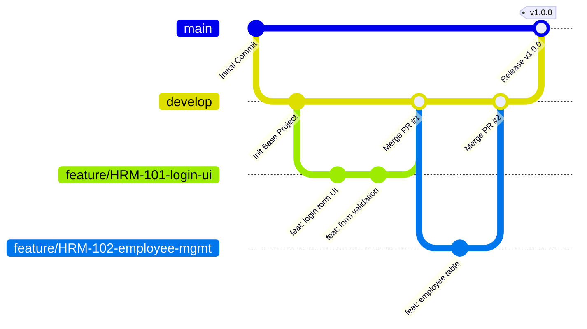

# QUY TRÌNH QUẢN LÝ MÃ NGUỒN VÀ LÀM VIỆC NHÓM (GIT WORKFLOW)
## DỰ ÁN: HỆ THỐNG QUẢN LÝ NHÂN SỰ (HRM - ICTU)
### Nhóm Phát triển Phần mềm | K23 - Khoa CNTT - ICTU

---

## 1. Giới thiệu & Mục tiêu

Mục tiêu của tài liệu này là chuẩn hóa toàn bộ quy trình làm việc với Git và GitHub cho nhóm phát triển phần mềm (quy mô từ 7 thành viên trở lên). Việc tuân thủ quy trình giúp:
- **Loại bỏ triệt để xung đột mã nguồn (Merge Conflicts)** giữa các thành viên.
- **Bảo vệ mã nguồn ổn định** trên nhánh chính, tránh tình trạng code lỗi bị đẩy lên làm hỏng môi trường của cả nhóm.
- **Minh bạch tiến độ công việc**, dễ dàng truy vết lịch sử thay đổi và liên kết trực tiếp với Backlog công việc.
- **Tạo thói quen chuyên nghiệp** tương đương môi trường doanh nghiệp phần mềm thực tế.

---

## 2. Chiến lược Phân nhánh (Branching Strategy)

### 2.1. Lựa chọn mô hình Git Flow phù hợp

Trong kỹ nghệ phần mềm có hai mô hình phổ biến:
1. **Full Git Flow**: Gồm các nhánh `main`, `develop`, `feature/*`, `release/*`, `hotfix/*`, `support/*`. Mô hình này phù hợp với các doanh nghiệp lớn có nhiều phiên bản phát hành song song và chu kỳ release kéo dài hàng tháng.
2. **Simplified Feature Branch Flow (`develop` + `feature/*` + `main`)**: Mô hình rút gọn nhưng bảo đảm đầy đủ tính an toàn và kỷ luật kỹ thuật.

👉 **LỰA CHỌN CỦA DỰ ÁN HRM ICTU:** Nhóm áp dụng **Simplified Feature Branch Flow**. Đây là mô hình tối ưu cho đồ án môn học và nhóm sinh viên vì:
- Dễ hiểu, giảm thiểu tối đa các bước checkout chuyển nhánh rườm rà.
- Nhánh `develop` đóng vai trò là "trạm tích hợp", nơi toàn bộ tính năng mới được ghép nối và kiểm thử.
- Nhánh `main` luôn ở trạng thái "sạch sẽ", chỉ chứa phiên bản hoàn chỉnh để báo cáo, demo với giảng viên hoặc nộp bài.



### 2.2. Chi tiết các nhánh trong dự án

| Tên nhánh | Mục đích sử dụng | Quy tắc truy cập & Bảo vệ |
| :--- | :--- | :--- |
| `main` | Chứa mã nguồn ổn định nhất, đã kiểm thử toàn diện, sẵn sàng bàn giao / demo. | **BẢO VỆ TUYỆT ĐỐI**: Cấm push trực tiếp. Chỉ được merge từ `develop` khi có sự đồng ý của Technical Lead. |
| `develop` | Nhánh tích hợp trung tâm của cả nhóm. Mọi tính năng hoàn thành đều merge về đây. | **BẢO VỆ**: Cấm push trực tiếp. Mọi thay đổi bắt buộc đi qua Pull Request (PR) có review. |
| `feature/*` | Phát triển các chức năng mới theo từng task trong Sprint Backlog. | Tách từ `develop`. Mỗi thành viên làm việc độc lập trên nhánh feature của mình. |
| `bugfix/*` | Sửa chữa các lỗi phát sinh trong quá trình tích hợp hoặc kiểm thử trên `develop`. | Tách từ `develop`. Merge ngược lại vào `develop` sau khi sửa xong và test pass. |
| `hotfix/*` | Sửa các lỗi nghiêm trọng khẩn cấp phát hiện trên `main` trong buổi demo. | Tách từ `main`. Sau khi sửa xong, merge đồng thời vào cả `main` và `develop`. |

---

## 3. Quy ước Đặt tên Nhánh (Branch Naming Convention)

Mọi nhánh làm việc phải tuân thủ nghiêm ngặt quy tắc đặt tên:

```text
<loại_nhánh>/<mã_task>-<mô_tả_ngắn_kebab_case>
```

### 3.1. Các tiền tố hợp lệ
- `feature/`: Dành cho việc thêm mới tính năng, giao diện, API, schema database.
- `bugfix/`: Dành cho việc sửa lỗi logic, lỗi giao diện, lỗi định dạng trong quá trình test.
- `hotfix/`: Dành cho việc vá lỗi khẩn cấp trực tiếp trên bản release `main`.
- `refactor/`: Tối ưu hóa cấu trúc mã nguồn mà không thay đổi hành vi người dùng.
- `docs/`: Thêm hoặc chỉnh sửa tài liệu đặc tả, hướng dẫn cài đặt.

### 3.2. Quy tắc mã Task
- Mã task bắt buộc lấy từ **Sprint Backlog** đã thống nhất (ví dụ: `HRM-101`, `HRM-102`, `HRM-201`).
- Nếu nhóm chưa có mã task tự động trên Jira, nhóm trưởng/thư ký thống nhất bảng mã trong file `docs/SPRINT_1_BACKLOG.md` hoặc Google Sheets chung.
- Tuyệt đối không tự ý bịa mã task tùy tiện.

### 3.3. Ví dụ thực tế
```text
✅ feature/HRM-101-login-ui
✅ feature/HRM-102-employee-management
✅ feature/HRM-103-department-api
✅ feature/HRM-104-attendance-logging
✅ bugfix/HRM-105-spa-router-fallback
✅ hotfix/HRM-106-database-connection-leak

❌ employee-page          (Sai: Không có loại nhánh, không có mã task)
❌ feature/FixLoiLogin    (Sai: Dùng tiếng Việt không dấu, CamelCase, sai loại)
❌ feat/hrm102            (Sai: Thiếu dấu gạch nối, không có mô tả chức năng)
```

---

## 4. Quy ước Commit (Conventional Commits)

Để lịch sử Git rõ ràng, chuyên nghiệp và có thể tự động tạo changelog, toàn bộ commit bắt buộc tuân theo quy chuẩn **Conventional Commits**:

```text
<type>(<scope>): <mô tả ngắn gọn bằng tiếng Anh hoặc tiếng Việt rõ nghĩa>
```

### 4.1. Các loại Commit Type

| Type | Ý nghĩa | Ví dụ trong dự án HRM |
| :--- | :--- | :--- |
| `feat` | Thêm mới tính năng hoặc giao diện | `feat(HRM-102): add employee table view and pagination` |
| `fix` | Sửa lỗi chương trình | `fix(HRM-105): resolve SPA router 404 on page refresh` |
| `docs` | Cập nhật tài liệu, README, hướng dẫn | `docs: add docker compose deployment guide` |
| `style` | Định dạng code (khoảng trắng, dấu chấm phẩy, format CSS) | `style(frontend): adjust button padding and hover colors` |
| `refactor` | Tái cấu trúc code (không đổi tính năng, không sửa bug) | `refactor(backend): extract database pool logic to config module` |
| `test` | Thêm bài kiểm thử (unit test, test cases) | `test(HRM-103): add syntax check and endpoint response tests` |
| `build` | Thay đổi hệ thống build hoặc dependencies | `build(frontend): update vite config and add alpine dockerfile` |
| `ci` | Thay đổi cấu hình GitHub Actions / pipeline | `ci: configure automated syntax check workflow` |
| `chore` | Các việc vặt phụ trợ không ảnh hưởng code chính | `chore: update .gitignore to exclude local temporary files` |

---

## 5. Quy trình Phát triển Phần mềm 12 Bước (Standard 12-Step Workflow)

Toàn bộ thành viên tuân thủ nghiêm ngặt 12 bước sau từ khi nhận việc đến khi hoàn tất:

```text
  [1. Nhận Task] ────────► [2. Đọc AC & Chuyển Status] ────────► [3. Pull Develop mới nhất]
                                                                        │
  [6. Commit chuẩn] ◄───── [5. Viết Code & Test Local] ◄────── [4. Tạo Feature Branch]
         │
         ▼
  [7. Push lên GitHub] ──► [8. Tạo Pull Request] ──────────────► [9. CI & Peer Review]
                                                                        │
  [12. Cập nhật Status] ◄─ [11. Squash & Merge] ◄────────────── [10. Fix góp ý (nếu có)]
```

### Chi tiết từng bước:

1. **Bước 1: Nhận Task**: Xem danh sách phân công trong Sprint Backlog. Xác định rõ người chịu trách nhiệm chính (Assignee).
2. **Bước 2: Cập nhật Trạng thái**: Chuyển thẻ task sang **In Progress**. Đọc kỹ Acceptance Criteria và Definition of Done.
3. **Bước 3: Đồng bộ `develop`**: Đảm bảo máy local có mã nguồn mới nhất:
   ```bash
   git checkout develop
   git pull origin develop
   ```
4. **Bước 4: Tạo nhánh Feature**: Tạo nhánh mới từ `develop` theo quy ước đặt tên:
   ```bash
   git checkout -b feature/HRM-102-employee-management
   ```
5. **Bước 5: Viết code và kiểm thử tại local**:
   - Chỉ chỉnh sửa các tệp trong phạm vi task.
   - Kiểm tra UI trên trình duyệt (`http://localhost:5173`), kiểm tra API bằng cURL/Postman (`http://localhost:3005`).
   - Chạy build và test local: `npm run build`, `npm test`, `docker compose config`.
6. **Bước 6: Commit theo quy ước**:
   - Chia nhỏ commit theo từng phần việc logic rõ ràng.
   - Dùng Conventional Commits: `feat(HRM-102): create employee table UI component`.
7. **Bước 7: Đẩy nhánh lên GitHub**:
   ```bash
   git push -u origin feature/HRM-102-employee-management
   ```
8. **Bước 8: Mở Pull Request (PR)**:
   - Vào GitHub repository, chọn tạo Pull Request vào nhánh `develop`.
   - Điền đầy đủ thông tin theo mẫu **Pull Request Template** có sẵn (mục tiêu, task ID, cách test, checklist DoD, ảnh chụp UI).
9. **Bước 9: CI chạy và Gửi Review**:
   - GitHub Actions CI sẽ tự động kích hoạt kiểm tra build và cú pháp.
   - Gắn Reviewer (ít nhất 1 đồng đội trong nhóm hoặc Tech Lead).
10. **Bước 10: Xử lý phản hồi (Address Feedback)**:
    - Nếu Reviewer yêu cầu chỉnh sửa, thực hiện thay đổi tại local và commit tiếp lên cùng nhánh, sau đó push lại. PR trên GitHub sẽ tự động cập nhật.
11. **Bước 11: Merge Pull Request**:
    - Khi PR đạt: (1) CI Xanh + (2) Reviewer đã Approve + (3) Thỏa mãn Definition of Done.
    - Tiến hành **Squash and Merge** vào nhánh `develop`.
12. **Bước 12: Dọn dẹp và Bàn giao**:
    - Xóa nhánh feature trên GitHub (nút *Delete branch*).
    - Cập nhật local: `git checkout develop && git pull origin develop`.
    - Xóa nhánh local: `git branch -d feature/HRM-102-employee-management`.
    - Chuyển trạng thái task trên Backlog sang **Done**.

---

## 6. Quy tắc Phối hợp Nhóm (Team Collaboration Guidelines)

Dự án có từ 7 thành viên trở lên, vì vậy quy tắc giao tiếp và trách nhiệm là yếu tố sống còn:

### 6.1. Nguyên tắc Trách nhiệm Cá nhân (Ownership)
- Mỗi task chỉ có **DUY NHẤT MỘT** người chịu trách nhiệm chính (Task Owner). Người này chịu trách nhiệm từ khâu viết code, kiểm thử, giải trình review đến khi code vào được nhánh `develop`.
- Khi cần hai người làm chung một module, phải chia nhỏ thành các sub-task rõ ràng (ví dụ: một bạn làm giao diện Frontend, một bạn làm API Backend).

### 6.2. Quy tắc Chạm file (File Conflict Avoidance)
- **Không sửa chéo file**: Nếu bạn đang làm task Quản lý phòng ban (`departments`), không được tự ý sửa file logic của module Quản lý chấm công (`attendances`) hay cấu hình kết nối database chung (`database.js`).
- Nếu nghiệp vụ bắt buộc phải sửa đổi file dùng chung (như `app.js`, `compose.yaml`, `style/design-tokens.css`), bắt buộc phải **trao đổi trước với Tech Lead** và các thành viên liên quan trên nhóm chat.

### 6.3. Quản lý Thay đổi Cơ sở Dữ liệu & API
- Khi Backend thay đổi hoặc bổ sung endpoint API mới, phải cập nhật tài liệu hoặc thông báo ngay cho Frontend Devs để cập nhật hàm gọi API.
- Khi có thay đổi bảng trong Database, phải cung cấp file migration/script mới trong thư mục `database/` và thông báo cho nhóm chạy cập nhật container MySQL.

### 6.4. Bảo vệ Nhánh trên GitHub (Branch Protection Rules - Đề xuất thiết lập)

Tech Lead / Repository Admin cấu hình trên GitHub Settings:
1. **Đối với nhánh `main` và `develop`**:
   - Bật: `Require a pull request before merging`.
   - Bật: `Require approvals` (tối thiểu 1 approval).
   - Bật: `Dismiss stale pull request approvals when new commits are pushed`.
   - Bật: `Require status checks to pass before merging` (chọn CI checks: `validate-compose`, `backend-check`, `frontend-check`).
   - Bật: `Do not allow bypassing the above settings`.

---

## 7. Hướng dẫn Thực tế: Kịch bản Thực hiện Task `HRM-102 – Quản lý nhân viên`

Dưới đây là bản mô phỏng từng câu lệnh thực tế mà thành viên thực hiện task `HRM-102` sẽ chạy từ đầu đến cuối:

### Giai đoạn 1: Chuẩn bị và Tạo nhánh
```bash
# 1. Di chuyển vào thư mục dự án
cd d:\QLNS_QLTKPM

# 2. Chuyển về nhánh develop và lấy code mới nhất
git checkout develop
git pull origin develop

# 3. Tạo nhánh tính năng mới từ develop
git checkout -b feature/HRM-102-employee-management
```

### Giai đoạn 2: Phát triển và Kiểm thử Local
```bash
# 4. Viết code giao diện quản lý nhân viên trong frontend/src/...
# 5. Kiểm thử cú pháp và build thử nghiệm
npm run build --prefix frontend
npm test --prefix backend
docker compose config

# 6. Kiểm tra danh sách file đã thay đổi
git status
```

### Giai đoạn 3: Commit và Đẩy lên GitHub
```bash
# 7. Thêm file vào staging
git add frontend/src/views/employees.js frontend/src/styles/pages.css

# 8. Commit theo Conventional Commits
git commit -m "feat(HRM-102): add employee table view, search and filter layout"

# 9. Tiếp tục hoàn thiện phần modal thêm nhân viên và commit tiếp
git add frontend/src/components/
git commit -m "feat(HRM-102): add employee creation modal with validation"

# 10. Đẩy nhánh lên repository từ xa
git push -u origin feature/HRM-102-employee-management
```

### Giai đoạn 4: Mở PR và Review
```bash
# 11. Mở trình duyệt, truy cập GitHub repository
# 12. Bấm "Compare & pull request"
#     - Base branch: develop
#     - Compare branch: feature/HRM-102-employee-management
# 13. Điền nội dung theo mẫu PR Template, đánh dấu checklist DoD.
# 14. Chọn Reviewer: @DongNghiep1
```

### Giai đoạn 5: Sửa phản hồi sau Review (nếu có)
```bash
# Giả sử Reviewer yêu cầu: "Bổ sung kiểm tra định dạng CCCD 12 chữ số"
# Thành viên sửa code tại local, sau đó:
git add frontend/src/utils/validation.js
git commit -m "fix(HRM-102): validate 12-digit format for citizen ID"
git push origin feature/HRM-102-employee-management
# (PR trên GitHub sẽ tự động cập nhật commit này)
```

### Giai đoạn 6: Hoàn tất Merge và Dọn dẹp
```bash
# Sau khi Reviewer bấm Approve và CI Xanh:
# 15. Bấm "Squash and merge" trên GitHub.
# 16. Bấm "Delete branch" trên GitHub.

# 17. Quay lại máy local đồng bộ:
git checkout develop
git pull origin develop

# 18. Xóa nhánh feature đã hoàn thành ở máy local
git branch -d feature/HRM-102-employee-management

# 19. Cập nhật thẻ task HRM-102 trên bảng quản lý sang trạng thái DONE!
```

---
*Tài liệu này được biên soạn bởi Technical Lead và phê duyệt để làm quy chuẩn chính thức cho toàn bộ thành viên dự án HRM ICTU.*
