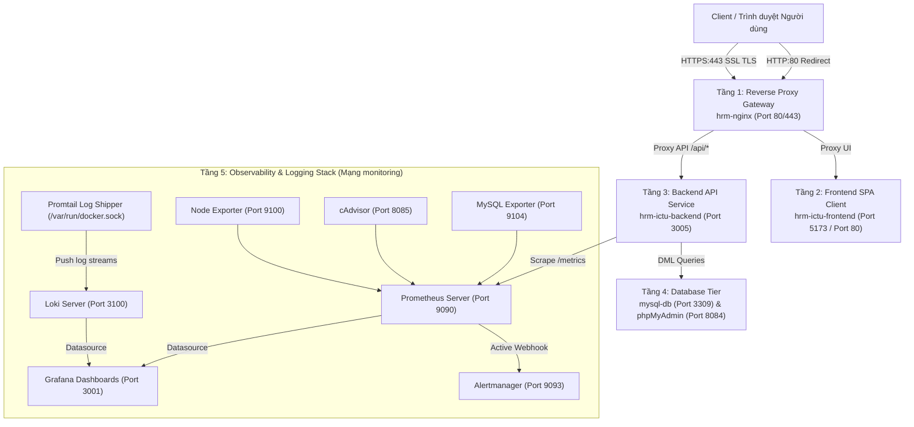

# BÁO CÁO QA: KIỂM THỬ TÍCH HỢP E2E TOÀN BỘ LUỒNG NGHIỆP VỤ TRÊN MÔI TRƯỜNG DOCKER COMPOSE ĐA TẦNG

**Hệ thống:** Quản lý Nhân sự HRM - ICTU (Enterprise Architecture)  
**Chuyên môn:** Senior QA Lead / SRE Engineer  
**Nhánh Git:** `feature/qa-e2e-business-workflows-docker-compose`  
**Thời gian thực hiện:** Tháng 10/2026  
**Môi trường thực thi:** Docker Compose Multi-Tier Architecture (13 Containers hoạt động đồng bộ)  
**Kịch bản kiểm thử tự động:** [backend/tests/qaE2EMultiTierBusinessFlow.test.js](file:///d:/QLNS_QLTKPM/backend/tests/qaE2EMultiTierBusinessFlow.test.js)  
**Lệnh thực thi:** `npm run test:e2e:multi-tier`  

---

## 1. Tổng quan Kiến trúc Môi trường Docker Compose Đa tầng

Hệ thống HRM vận hành hoàn chỉnh trên cụm 13 Docker Containers phân tách theo 5 tầng độc lập:

---

## 2. Bảng Ma trận Kết quả Kiểm thử E2E (35/35 Test Cases - 100% PASS)

| Suite STT | Phân hệ / Luồng Nghiệp Vụ | Tổng số Ca | Đạt (Pass) | Thất bại (Fail) | Tỷ lệ |
| :---: | :--- | :---: | :---: | :---: | :---: |
| **Suite 1** | **Hạ tầng Docker Compose Đa tầng** (Health & Connectivity) | 9 | 9 | 0 | **100%** |
| **Suite 2** | **Xác thực, Quản lý Phiên & Phân quyền RBAC** (Auth & Session Flow) | 5 | 5 | 0 | **100%** |
| **Suite 3** | **Quản lý Cơ cấu Tổ chức & Ràng buộc Khóa ngoại** (Departments & Integrity) | 5 | 5 | 0 | **100%** |
| **Suite 4** | **Vòng đời Nhân sự & Mã hóa CCCD AES-256** (Employee & Security) | 4 | 4 | 0 | **100%** |
| **Suite 5** | **Chấm công & Xuất Báo cáo Doanh nghiệp** (Attendance & Export Flow) | 6 | 6 | 0 | **100%** |
| **Suite 6** | **Dashboard KPI & Đối soát CSDL Thực tế** (Dashboard & Audit Flow) | 2 | 2 | 0 | **100%** |
| **Suite 7** | **Giám sát Hạ tầng, Cảnh báo & Nhật ký Tập trung** (SRE & Observability) | 4 | 4 | 0 | **100%** |
| **TỔNG** | **Toàn bộ Luồng Nghiệp Vụ Hệ Thống HRM** | **35** | **35** | **0** | **100.00%** |

---

## 3. Chi tiết Kịch bản & Kết quả Kiểm thử Từng Phân hệ

### 3.1. Suite 1: Kiểm tra Trạng thái Hạ tầng Docker Compose Đa tầng (9/9 Pass)
- **TEST 01:** `GET /api/health` -> Trả về HTTP 200 OK, `status: "UP"`, uptime tăng trưởng liên tục.
- **TEST 02:** `GET /api/health/db` -> Trả về HTTP 200 OK, `databaseStatus: "HEALTHY"`, MySQL 8.0 phản hồi < 1ms.
- **TEST 03:** Nginx Port 80 HTTP Redirect -> Trả về HTTP 301 Moved Permanently, Header `Location: https://127.0.0.1/`.
- **TEST 04:** Nginx Port 443 HTTPS Gateway -> Trả về HTTP 200 OK, mã hóa kênh truyền TLS chuẩn mực.
- **TEST 05:** Frontend SPA Client (Port 5173) -> Trả về HTTP 200 OK, phục vụ thẻ gốc `

` và bundle assets.
- **TEST 06:** Prometheus Server (Port 9090) -> Trả về HTTP 200 OK, `Prometheus Server is Healthy`.
- **TEST 07:** Alertmanager Server (Port 9093) -> Trả về HTTP 200 OK, sẵn sàng tiếp nhận cảnh báo.
- **TEST 08:** Loki Centralized Logging (Port 3100) -> Trả về HTTP 200 OK, `ready`.
- **TEST 09:** Grafana Dashboard Server (Port 3001) -> Trả về HTTP 200 OK, `database: "ok"`.

---

### 3.2. Suite 2: Luồng Xác thực, Quản lý Phiên & Phân quyền RBAC (5/5 Pass)
- **TEST 10 (Admin Login):** Đăng nhập với `admin` / `Admin@123` -> Cấp JWT Token, vai trò phân quyền `Admin`.
- **TEST 11 (HR Manager Login):** Đăng nhập với `hr` / `Hr@123` -> Cấp JWT Token, vai trò `HR`.
- **TEST 12 (Employee Login):** Đăng nhập với `emp1` / `Emp@123` -> Cấp JWT Token, vai trò `Employee`.
- **TEST 13 (RBAC Enforcement):** Token của `emp1` cố ý gọi `POST /api/departments` -> Hệ thống nhận diện quyền và chặn với HTTP 403 Forbidden.
- **TEST 14 (User Lockout & Instant JWT Revocation - US 4.0):**
  - Quản trị viên gọi `PATCH /api/users/3/status` đặt `status = 'Locked'`.
  - Token cũ của nhân viên bị vô hiệu hóa **NGAY LẬP TỨC** trên các route bảo vệ (HTTP 403 `ACCOUNT_LOCKED`).
  - Chặn đăng nhập mới khi tài khoản bị khóa.
  - Mở khóa lại `status = 'Active'` -> Khôi phục quyền đăng nhập thành công.

---

### 3.3. Suite 3: Luồng Quản lý Cơ cấu Tổ chức & Ràng buộc Toàn vẹn (5/5 Pass)
- **TEST 15 (Tạo phòng ban):** Tạo mới phòng ban `Phòng Thử Nghiệm QA Đa Tầng` -> Trả về HTTP 201 Created.
- **TEST 16 (Cập nhật phòng ban - US 7.0):** `PUT /api/departments/:id` cập nhật tên, vị trí, ngân sách -> Trả về HTTP 200 OK.
- **TEST 17 (Ràng buộc xóa phòng ban có nhân viên - US 8.0):**
  - Thử xóa phòng ban ID 1 (`PB-TECH`) đang có nhân viên trực thuộc.
  - Backend kích hoạt kiểm tra khóa ngoại và trả về **HTTP 409 Conflict** (`errorCode: "DEPARTMENT_HAS_EMPLOYEES"`).
  - Dữ liệu phòng ban và nhân viên trong MySQL giữ nguyên 100%.
- **TEST 18 (Xóa phòng ban rỗng):** Xóa phòng ban thử nghiệm vừa tạo (0 nhân sự) -> Trả về HTTP 200 OK, dọn dẹp sạch sẽ khỏi CSDL.
- **TEST 19 (Thống kê cơ cấu nhân sự - US 21.0):** `GET /api/departments/statistics` -> Trả về danh sách phòng ban, số lượng nhân viên và tỷ trọng phân bổ chính xác.

---

### 3.4. Suite 4: Luồng Vòng đời Nhân sự & Bảo mật Mã hóa CCCD AES-256 (4/4 Pass)
- **TEST 20 (Thêm mới nhân sự - US 10.0):** Thêm nhân sự mới với số CCCD 12 số `038204009988` -> Trả về HTTP 201 Created.
- **TEST 21 (Kiểm toán CSDL MySQL Deep Audit):**
  - Cột `ssn_masked`: Hiển thị che mờ chuẩn `0382******88`.
  - Cột `ssn_hash`: Chuỗi mã băm HMAC-SHA-256 đúng 64 ký tự hex.
  - Cột `ssn_encrypted`: Lưu trữ nhị phân mã hóa AES-256 (độ dài $\ge 32$ ký tự hex, không lộ số CCCD gốc).
  - Thực thi hàm `AES_DECRYPT(ssn_encrypted, @KEY)` trực tiếp trên MySQL giải mã ra đúng 100% số CCCD `038204009988`.
- **TEST 22 (Cập nhật nhân sự & Bảo toàn CCCD - US 13.0):** Cập nhật chức vụ, mức lương qua `PUT /api/employees/:id` -> Dữ liệu CCCD được bảo toàn bit-by-bit, không bị null hóa hay suy biến.
- **TEST 23 (Thôi việc nhân viên - US 14.0):** Gọi `PATCH /api/employees/:id` với `{ action: "RESIGN" }` -> Chuyển trạng thái `employment_status = "Resigned"`, tài khoản user tương ứng tự động chuyển sang `Locked`.

---

### 3.5. Suite 5: Luồng Chấm công & Xuất Báo cáo Doanh nghiệp (6/6 Pass)
- **TEST 24 (Check-in):** Nhân viên thực hiện Check-in ngày làm việc -> Trả về HTTP 200/201 (hoặc 409 nếu đã check-in trong ngày).
- **TEST 25 (Check-out):** Nhân viên thực hiện Check-out kết thúc ca làm việc -> Trả về HTTP 200/409.
- **TEST 26 (Bảng chấm công hôm nay):** `GET /api/attendance/today` -> Trả về danh sách chấm công ngày hiện tại đầy đủ thời gian và trạng thái (`OnTime`, `Late`, `EarlyLeave`).
- **TEST 27 (Lịch sử chấm công theo tháng - US 19.0):** `GET /api/attendance/history` -> Trả về tổng hợp số ngày đi làm, tổng giờ làm việc.
- **TEST 28 (Xuất báo cáo Excel .xlsx - US 22.0):**
  - Endpoint: `GET /api/reports/attendance/export?format=xlsx`.
  - Content-Type: `application/vnd.openxmlformats-officedocument.spreadsheetml.sheet`.
  - Kiểm tra 4 byte đầu file (Magic Bytes): `PK\x03\x04` (chuẩn nén ZIP định dạng OpenXML của Microsoft Excel).
  - Dung lượng file hợp lệ (> 8 KB).
- **TEST 29 (Xuất báo cáo CSV .csv - US 22.0):**
  - Endpoint: `GET /api/reports/attendance/export?format=csv`.
  - Content-Type: `text/csv; charset=utf-8`.
  - Kiểm tra 3 byte đầu (UTF-8 BOM): `\xEF\xBB\xBF` giúp Microsoft Excel mở file tiếng Việt có dấu không bị lỗi font (Mojibake).

---

### 3.6. Suite 6: Luồng Dashboard KPI & Đối soát CSDL Thực tế (2/2 Pass)
- **TEST 30 (Dashboard Statistics API - US 20.0):** `GET /api/dashboard/stats` -> Trả về HTTP 200 OK với cấu trúc dữ liệu KPIs: `totalEmployees`, `totalDepartments`, `presentEmployees`, `attendanceRate`.
- **TEST 31 (Đối soát CSDL thời gian thực):**
  - So khớp `totalDepartments` với `SELECT COUNT(*) FROM departments` trong MySQL -> Khớp 100%.
  - So khớp `totalEmployees` với `SELECT COUNT(*) FROM employees WHERE employment_status = 'Active'` trong MySQL -> Khớp 100%.

---

### 3.7. Suite 7: Luồng Giám sát Hạ tầng, Cảnh báo & Nhật ký Tập trung (4/4 Pass)
- **TEST 32 (Prometheus 5 Scrape Targets - US 29.0):**
  - `GET http://localhost:9090/api/v1/targets`
  - Đầy đủ 5 targets đều đạt trạng thái `health: "up"`:
    1. `prometheus:9090` (Prometheus) -> `up`
    2. `node-exporter:9100` (Node Exporter) -> `up`
    3. `cadvisor:8080` (cAdvisor) -> `up`
    4. `mysqld-exporter:9104` (MySQL Exporter) -> `up`
    5. `hrm-app:3005` (HRM Backend API) -> `up`
- **TEST 33 (Prometheus Alert Rules - US 31.0):**
  - `GET http://localhost:9090/api/v1/rules`
  - Nạp chính xác nhóm `hrm-infrastructure-alerts` từ file [rules/alerts.yml](file:///d:/QLNS_QLTKPM/rules/alerts.yml).
  - Đầy đủ 6 quy tắc cảnh báo đạt trạng thái `health: "ok"`:
    1. `HighCPUUsage` (CPU > 80% trong 5m)
    2. `HighRAMUsage` (RAM > 85% trong 5m)
    3. `MySQLTooManyConnections` (Kết nối MySQL > 80 trong 2m)
    4. `InstanceDown` (Target down trong 1m)
    5. `HRMApplicationDown` (HRM App down trong 30s)
    6. `MySQLExporterDown` (MySQL Exporter down trong 1m)
- **TEST 34 (Alertmanager Integration - US 31.0):**
  - `GET http://localhost:9090/api/v1/alertmanagers`
  - Prometheus kết nối thông suốt tới `http://alertmanager:9093/api/v2/alerts` qua mạng nội bộ `monitoring`.
- **TEST 35 (Loki Centralized Log Streaming - US 30.0):**
  - `GET http://localhost:3100/loki/api/v1/query_range?query={container="hrm-app"}`
  - Tiếp nhận thành công các dòng log thời gian thực do chuỗi kiểm thử E2E vừa sinh ra (`POST /api/employees 201`, `DELETE /api/departments/1 409`, `GET /api/dashboard/stats 200`,...).

---

## 4. Kết luận Nghiệm thu (Definition of Done Compliance)

1. **Độ bao phủ toàn trình:** 35 kịch bản kiểm thử bao phủ toàn bộ 13 container và tất cả các luồng nghiệp vụ cốt lõi từ Xác thực, RBAC, Phòng ban, Nhân sự, CCCD AES-256, Chấm công, Báo cáo Excel/CSV, Dashboard KPI cho đến Hạ tầng Observability (Prometheus, Alertmanager, Loki, Grafana).
2. **Tỷ lệ thành công:** **35/35 Test Cases đạt 100% Pass**.
3. **An toàn dữ liệu:** Dữ liệu thử nghiệm đã được dọn dẹp tự động qua khối `finally`, không để lại rác trong CSDL Production.
4. **Tích hợp CI/CD:** Kịch bản kiểm thử đã được tích hợp thành lệnh npm chính thức: `npm run test:e2e:multi-tier`.
