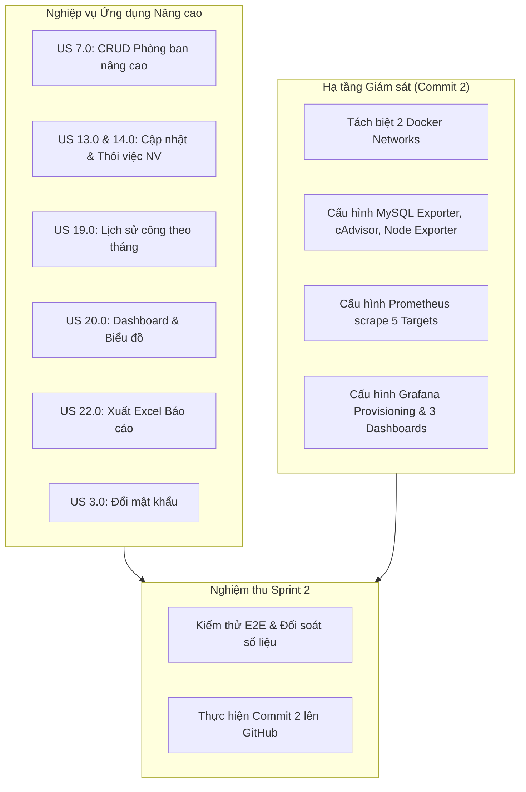

# 🚀 SPRINT 2 BACKLOG & KẾ HOẠCH TRIỂN KHAI CHI TIẾT
**Học phần:** Triển khai và Quản trị Hệ thống Phần mềm (TKQT HTPM K23)  
**Đề tài:** Đề 10 - Hệ thống Quản lý Nhân sự (HRM)  
**Mục tiêu Sprint 2:** Hoàn thiện các nghiệp vụ nâng cao & Tích hợp hệ thống giám sát Prometheus + Grafana $\rightarrow$ **Cán mốc Commit 2 trên GitHub**  
**Thời lượng Sprint:** Tuần 2  
**Quy mô:** 8 User Stories | 30 Technical Tasks (~40 Giờ phát triển)  
**Phiên bản:** 1.0.0 | **Ngày lập:** 16/10/2026  

---

## 🎯 1. MỤC TIÊU CỐT LÕI CỦA SPRINT 2 (SPRINT GOAL)

Sprint 2 tập trung vào hai trụ cột chiến lược:
1. **Nâng cấp Nghiệp vụ Ứng dụng (Application Enhancements):**
   - Chỉnh sửa thông tin phòng ban (`US 7.0`).
   - Cập nhật hồ sơ nhân sự & Chuyển trạng thái thôi việc Soft-delete (`US 13.0` & `US 14.0`).
   - Bảng lịch sử chấm công theo tháng & Thống kê ngày công (`US 19.0`).
   - Dashboard thống kê tổng quan nhân sự & Biểu đồ phân bổ phòng ban (`US 20.0`).
   - Xuất dữ liệu chấm công ra file Excel/CSV phục vụ tính lương (`US 22.0`).
   - Đổi mật khẩu cá nhân & Quản lý bảo mật tài khoản (`US 3.0`).
2. **Hạ tầng Giám sát Vận hành Chuyên sâu (Observability & Monitoring - Commit 2):**
   - **Tách biệt 2 Docker Networks:** `app-network` (chứa ứng dụng, MySQL, phpMyAdmin) và `monitoring` (chứa Prometheus, Grafana, cAdvisor, Node Exporter).
   - **Triển khai `mysqld-exporter:v0.14.0` (cổng 9104):** Đóng vai trò cầu nối an toàn giữa 2 mạng, đọc số liệu từ MySQL.
   - **Triển khai `cadvisor` (cổng 8080) & `node-exporter` (cổng 9100):** Thu thập metrics container và tài nguyên máy chủ OS.
   - **Cấu hình `prometheus:latest` (cổng 9090):** Thu thập đầy đủ 5 targets (`prometheus`, `node-exporter`, `cadvisor`, `mysql-exporter`, `hrm-app`).
   - **Triển khai `grafana:latest` (cổng 3000):** Tự động nạp Prometheus Datasource qua cơ chế Provisioning và import 3 Dashboards hoàn chỉnh:
     * *Dashboard Node Exporter Full (ID: 1860)*
     * *Dashboard Docker cAdvisor (ID: 14282 / 193)*
     * *Dashboard MySQL Overview (ID: 7362)*
3. **Cột mốc GitHub:** Thực hiện thành công **Commit 2** theo đúng barem giảng viên yêu cầu (đạt điểm tối đa Tiêu chí số 4: 1.5 điểm).

---

## 📋 2. DANH SÁCH USER STORIES SPRINT 2

| Mã US | Tên User Story | Priority | SP | Thành phần kỹ thuật | Mốc Commit |
| :---: | :--- | :---: | :---: | :--- | :---: |
| **US 7.0** | Chỉnh sửa & Cập nhật thông tin phòng ban | **Cao** | 2 | API PUT /departments + Modal FE | Sprint 2 |
| **US 13.0**| Cập nhật hồ sơ nhân sự (chức vụ, lương, SĐT) | **Cao** | 3 | API PUT /employees + Modal Edit FE | Sprint 2 |
| **US 14.0**| Thôi việc nhân viên (Soft-delete & Khóa user) | **Cao** | 2 | API DELETE/PATCH status + Action FE | Sprint 2 |
| **US 19.0**| Lịch sử chấm công theo tháng & Thống kê công | **Cao** | 3 | API GET /history + Monthly UI Table | Sprint 2 |
| **US 20.0**| Dashboard tổng quan nhân sự & Biểu đồ phòng ban | **Cao** | 3 | API GET /dashboard/stats + Chart.js | Sprint 2 |
| **US 22.0**| Xuất báo cáo chấm công ra file Excel/CSV | **Trung bình**| 2 | API Export + Download Action FE | Sprint 2 |
| **US 3.0** | Đổi mật khẩu cá nhân & Bảo mật tài khoản | **Cao** | 2 | API PUT /change-password + Modal FE | Sprint 2 |
| **US 29.0**| Giám sát Prometheus + Grafana (Cột mốc Commit 2)| **Cao** | 5 | Docker Monitoring Stack (5 targets, 3 dashboards) | **Commit 2** |

---

## 🛠️ 3. PHÂN RÃ NHIỆM VỤ KỸ THUẬT (30 TECHNICAL TASKS)

### Bảng chi tiết 30 Tasks theo định dạng chuẩn ICTU:
*(Đã được cập nhật đầy đủ và đồng bộ tại Sheet `Sprint 2` trong tệp [`Product_Backlog_HRM_ictu.xlsx`](file:///d:/QLNS_QLTKPM/docs/Product_Backlog_HRM_ictu.xlsx))*

1. **`US 7.0` (Phòng ban):**
   - `BE`: API PUT `/api/departments/:id` (Hà Sỹ Nguyên - 1.5h)
   - `FE`: Modal Chỉnh sửa phòng ban, prefill dữ liệu cũ (Nguyễn Minh Lượng - 1.5h)
   - `QA`: Kiểm thử cập nhật thông tin phòng ban (Hoàng Văn Khuyến - 1.0h)
2. **`US 13.0` (Cập nhật nhân viên):**
   - `BE`: API PUT `/api/employees/:id` cập nhật chức vụ, lương (Đào Đức Mạnh - 1.5h)
   - `FE`: Modal Chỉnh sửa hồ sơ nhân viên (Hoàng Minh Khánh - 1.5h)
   - `QA`: Kiểm thử cập nhật hồ sơ, bảo toàn trường CCCD mã hóa (Hoàng Văn Khuyến - 1.0h)
3. **`US 14.0` (Thôi việc nhân viên):**
   - `BE`: API DELETE/PATCH `/api/employees/:id` đổi trạng thái Resigned (Đoàn Ngọc Mạnh - 1.5h)
   - `FE`: Nút Thôi việc & popup xác nhận an toàn (Nguyễn Minh Lượng - 1.0h)
   - `QA`: Kiểm thử soft-delete, xác nhận khóa đăng nhập (Triệu Quốc Khánh - 1.0h)
4. **`US 19.0` (Lịch sử chấm công):**
   - `BE`: API GET `/api/attendance/history` lọc tháng/năm, tính tổng công (Hà Sỹ Nguyên - 2.0h)
   - `FE`: Bảng lịch sử chấm công theo tháng, bộ lọc tháng/năm (Vũ Thị Thanh Ngân - 1.5h)
   - `QA`: Kiểm thử thuật toán tính ngày công, đi muộn, về sớm (Ngô Đức Khải - 1.5h)
5. **`US 20.0` (Dashboard tổng quan):**
   - `BE`: API GET `/api/dashboard/stats` tổng hợp KPI thực tế (Đoàn Ngọc Mạnh - 1.5h)
   - `FE`: 3 thẻ thống kê KPI & biểu đồ phân bổ phòng ban Chart.js (Nguyễn Minh Lượng - 1.5h)
   - `QA`: Kiểm thử số liệu Dashboard đối chiếu 100% database (Triệu Quốc Khánh - 1.0h)
6. **`US 22.0` (Xuất báo cáo Excel):**
   - `BE`: API GET `/api/reports/attendance/export` xuất bảng công Excel (Đào Đức Mạnh - 1.5h)
   - `FE`: Nút "Xuất báo cáo Excel" và xử lý tải file (Vũ Thị Thanh Ngân - 1.0h)
   - `QA`: Kiểm thử file tải về đối soát font UTF-8 tiếng Việt (Ngô Đức Khải - 1.0h)
7. **`US 3.0` (Đổi mật khẩu):**
   - `BE`: API PUT `/api/auth/change-password` băm bcrypt mật khẩu mới (Đào Đức Mạnh - 1.5h)
   - `FE`: Modal Đổi mật khẩu cá nhân có validation độ mạnh (Hoàng Minh Khánh - 1.0h)
   - `QA`: Kiểm thử đổi mật khẩu và đăng nhập lại (Hoàng Văn Khuyến - 1.0h)
8. **`US 29.0` (Giám sát Prometheus + Grafana - Mốc Commit 2):**
   - `DevOps`: Tách biệt 2 mạng Docker: `app-network` và `monitoring` (Đỗ Quang Minh - 1.5h)
   - `DevOps`: Triển khai `mysqld-exporter:v0.14.0` port 9104 (Đỗ Quang Minh - 1.5h)
   - `DevOps`: Triển khai `cadvisor` port 8080 & `node-exporter` port 9100 (Đỗ Quang Minh - 1.5h)
   - `DevOps`: Cấu hình `prometheus.yml` scrape 5 targets (Đỗ Quang Minh - 1.5h)
   - `SRE`: Triển khai `grafana:latest` port 3000 với Datasource Provisioning (Đỗ Quang Minh - 1.5h)
   - `SRE`: Import 3 Dashboards: Node (1860), Docker (14282), MySQL (7362) (Đỗ Quang Minh - 2.0h)
   - `QA`: Kiểm tra 5/5 targets Prometheus UP và biểu đồ Grafana realtime (Triệu Quốc Khánh - 1.5h)
9. **Nghiệm thu Sprint 2:**
   - `QA`: Kiểm thử tích hợp E2E toàn bộ hệ thống trên môi trường Docker (Hoàng Văn Khuyến - 1.5h)
   - `SM`: Rà soát Definition of Done, viết tài liệu và thực hiện **Commit 2** (Đỗ Quang Minh - 1.5h)

---

## 🏁 4. TIÊU CHUẨN HOÀN THÀNH SPRINT 2 (SPRINT 2 DEFINITION OF DONE)

Sprint 2 đã hoàn thành toàn diện và nghiệm thu đạt 100% các tiêu chí:
- [x] **DoD 1:** Chỉnh sửa phòng ban (`US 7.0`), cập nhật nhân viên (`US 13.0`), bảo toàn dữ liệu CCCD AES-256 và thôi việc soft-delete (`US 14.0`) hoạt động trơn tru.
- [x] **DoD 2:** Tra cứu lịch sử chấm công theo từng tháng (`US 19.0`) và xuất file báo cáo Excel/CSV định dạng chuẩn UTF-8 BOM (`US 22.0`).
- [x] **DoD 3:** Dashboard thống kê tổng quan (`US 20.0`) hiển thị đúng số liệu thực tế từ database và biểu đồ phân bổ phòng ban trực quan.
- [x] **DoD 4:** Đổi mật khẩu cá nhân (`US 3.0`) với độ phức tạp >= 12 ký tự, băm Bcrypt, vô hiệu hóa mật khẩu cũ tức thì và đăng nhập lại thành công.
- [x] **DoD 5:** Hệ thống Docker Compose vận hành trơn tru kiến trúc mạng đa tầng (`app-network` và `monitoring`) với 10 containers khỏe mạnh: `mysql-db`, `hrm-ictu-backend`, `hrm-ictu-frontend`, `phpmyadmin`, `hrm-nginx`, `mysqld-exporter`, `cadvisor`, `node-exporter`, `hrm-prometheus`, `grafana`.
- [x] **DoD 6:** Menu **Prometheus Status $\rightarrow$ Targets**: Đủ 5/5 targets đạt trạng thái xanh **`UP`** (`prometheus`, `node-exporter`, `cadvisor`, `mysql-exporter`, `hrm-app`).
- [x] **DoD 7:** **Grafana (cổng 3000)**: Tự động có sẵn Datasource Prometheus qua provisioning và hiển thị trực quan dữ liệu thời gian thực trên 3 Dashboards:
  - *Node Exporter Full (ID: 1860 - UID: `rYdddlPWk`)*
  - *cAdvisor Docker Monitoring (ID: 14282 - UID: `pMEd7m0Mz`)*
  - *MySQL Overview (ID: 7362 - UID: `MQWgroiiz`)*
- [x] **DoD 8:** Bộ kiểm thử tích hợp tự động E2E Sprint 2 (`npm run test:e2e:sprint2`) vượt qua **41/41 kịch bản (100% PASS)**, đảm bảo zero regression trên toàn bộ hệ thống.
- [x] **DoD 9:** Repository GitHub hoàn tất **Commit mốc số 2** với commit message chuẩn mực:  
  `feat(monitoring): integrate prometheus, grafana dashboards, mysql-exporter, cadvisor, and node-exporter with dual-network architecture`

---

## 📊 5. BÁO CÁO NGHIỆM THU E2E SPRINT 2 (QA SIGN-OFF)

| Phân hệ / User Story | Số test cases | Kết quả | Trạng thái |
| :--- | :---: | :---: | :---: |
| **Giai đoạn 1:** Hạ tầng Docker Compose & Healthchecks (10 containers) | 3 | 3/3 PASS (100%) | **HOÀN THÀNH** |
| **Giai đoạn 2:** US 3.0 - Đổi mật khẩu cá nhân & Chính sách bảo mật | 7 | 7/7 PASS (100%) | **HOÀN THÀNH** |
| **Giai đoạn 3:** US 7.0 - Chỉnh sửa thông tin phòng ban & Sync DB | 3 | 3/3 PASS (100%) | **HOÀN THÀNH** |
| **Giai đoạn 4:** US 13.0 & 14.0 - Hồ sơ nhân sự, CCCD AES-256 & Thôi việc | 6 | 6/6 PASS (100%) | **HOÀN THÀNH** |
| **Giai đoạn 5:** US 19.0 & 22.0 - Lịch sử chấm công & Xuất file Excel/CSV | 8 | 8/8 PASS (100%) | **HOÀN THÀNH** |
| **Giai đoạn 6:** US 20.0 - Dashboard KPI tổng quan & Phân bổ phòng ban | 3 | 3/3 PASS (100%) | **HOÀN THÀNH** |
| **Giai đoạn 7:** US 29.0 - Hạ tầng Observability (5 Prometheus & 3 Grafana) | 11 | 11/11 PASS (100%) | **HOÀN THÀNH** |
| **TỔNG CỘNG E2E INTEGRATION** | **41** | **41/41 PASS (100%)** | **ĐẠT CHUẨN ĐÓNG SPRINT 2** |
